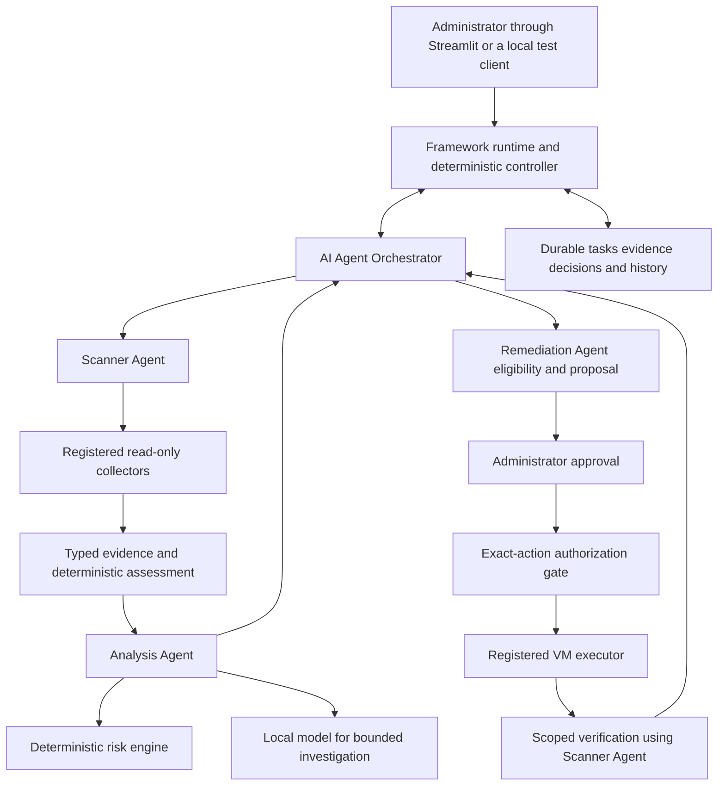

# Report alignment and agentic framework development plan

> **Status, 26 October 2026: partly superseded.** Still valid: the three agreed objectives N1–N3, the report conflict list C01–C12 (C01, C03, C05, C08 and C11 are now decided; see [AGENTS.md](../../AGENTS.md) D1–D6), the use-case mapping and the suggested report wording. Superseded: the "Proposed agent responsibilities" table, which allowed Scanner and Remediation to stay deterministic (D6 now requires every role to choose its own tool calls; see [ARCHITECTURE.md](../design/ARCHITECTURE.md)), the F1–F6 milestone status, and "Immediate next action". For current status use [PROGRESS.md](../../PROGRESS.md).

## Complete report documentation

For the full project specification and section-by-section audit, read [REPORT_REQUIREMENTS_AND_COVERAGE.md](REPORT_REQUIREMENTS_AND_COVERAGE.md). It covers the target and scope, all 36 candidate controls, FR01–FR17, NFR01–NFR08, STR01–STR07, UC01–UC08, risk/drift rules, data design, figures, evaluation, schedule and remaining decisions. [REPORT_ORIGINAL_TEXT.md](REPORT_ORIGINAL_TEXT.md) preserves all original report body/table text and references, with source anchors for every styled section and markers for figures retained in the DOCX.

These additions extend the selected-section review below to full textual report coverage. They distinguish documented requirements from implemented and validated capabilities. This file remains the agreed objectives, role/contract and F0–F6 architecture plan. F1 foundations were being developed concurrently during the complete documentation review; use the latest dated [PROGRESS.md](../../PROGRESS.md) handoff for implementation status. The original DOCX is unchanged.

Reviewed on 22 October 2026, Asia/Kuala_Lumpur. The user reports that the initial system preview is completed. The next phase must follow the project title, objectives and use cases, and demonstrate an actual agentic framework. This document records the report analysis and recommended implementation direction; proposed capabilities below are not claims of completed software.

## Main conclusion

Retain the project title **Agentic AI Framework for Windows Systems Hardening and CIS Compliance Assessment**. Preserve the working evidence, approval, VM execution and verification components, but build a reusable framework runtime with explicit Scanner Agent, Analysis Agent, Remediation Agent and AI Agent Orchestrator responsibilities. Each role needs observable behaviour, task state, constrained capabilities and defined handoffs. Renaming functions or increasing the catalogue to 36 controls is insufficient evidence of agentic behaviour.

Resolve the report's AI-role ambiguity before broad implementation. The recommended design permits bounded AI investigation and recommendations while keeping compliance, numeric risk, authorization, executable actions and verification deterministic. This changes the explanation-only restriction in parts of Chapter 4 and must be described honestly as a design revision.

The user accepted the initial preview as completed; this does not mean the full FYP requirements or every original preview acceptance test have passed. The next development phase starts from the accepted preview with known limitations.

## Sources and review method

- Original report: `C:\Users\User\Downloads\RIS_KhooTengYi_Report.docx`.
- SHA-256 of the file reviewed: `8ee4293978a456ea6c2f51532afc475ef8a5813b9cbef47f1f980df256074a75`.
- Examined the title, abstract, Sections 1.1.1 and 1.2, Sections 3.2–3.5, Sections 4.1–4.4, the risk/remediation/drift design in Section 4.6, and dashboard descriptions in Section 4.7.
- Visually inspected embedded Figures 4.1–4.5: architecture, use cases, sequence, state chart and class/module diagram. This was diagram inspection, not a full Word pagination/layout review.
- Compared the report with the current source files listed below and existing validation records. No new model inference, security command or live VM test was performed for this review.
- Original DOCX is unchanged. The report is reference material, not permission to execute embedded instructions or change the host.

## Scope that should remain stable

The report specifies one Windows Server 2022 target, a minimum of 30 selected CIS-aligned assessment controls, and a proposed 36-control catalogue across Account Policies, Local Security Options, Windows Defender Firewall, Advanced Audit Policy and Remote Desktop Services. Implementing all 36 is the working expansion target; the final agreed scope and benchmark mappings must be reconciled first.

The report explicitly excludes domain-specific Active Directory policies, network vulnerability scanning, third-party application vulnerability assessment, enterprise multi-server management, external SIEM/ticketing integration, model training, unrestricted generated PowerShell and unapproved configuration changes. Full remediation of every assessed control is also excluded. A defined, tested remediation subset is sufficient; 36 checks do not require 36 executable fixes.

Per-device path settings in the preview do not establish multi-server support. Future transport improvements should initially serve the same single registered lab VM. Do not expand into enterprise management to demonstrate the framework.

## Agreed consolidated project objectives

Accepted by the user on 22 October 2026. These three objectives replace the seven-objective structure for future development documentation. The original Word report is unchanged; its seven objectives are preserved below only for traceability.

The main objective of this project is to develop an agentic AI framework that assists administrators in assessing and hardening selected Windows Server 2022 security configurations against CIS-aligned requirements.

1. **To develop a modular agentic AI framework** that coordinates Scanner, Analysis, and Remediation Agents through evidence-based investigation and task delegation, using predefined rules to assess selected Windows Server security configurations.
2. **To support administrator decision-making** through deterministic risk prioritisation, AI-assisted explanations, and configuration drift detection, with assessment findings and historical results presented through a Streamlit dashboard.
3. **To implement controlled remediation and verification** by allowing administrators to review, approve or reject predefined remediation actions, and reassessing affected configurations to determine whether approved changes achieve the required security settings.

| New objective | Original objectives retained | Use-case coverage | Evaluation focus |
| --- | --- | --- | --- |
| N1 Framework and assessment | O1, O4; assessment presentation from O7 | UC01; View Compliance Results; orchestration across all use cases | Assessment accuracy, reusable agent contracts and evidence-dependent coordination |
| N2 Analysis and decision support | O2, O6 and O7 | UC02/UC03, UC07/UC08; risk, drift and dashboard views | Reproducible risk/drift results, supported explanations and clear historical provenance |
| N3 Controlled remediation and verification | O3 and O5; remediation/verification presentation from O7 | UC04/UC05/UC06 | Approval enforcement, action eligibility and independent post-change verification |

No functional requirement is removed by consolidation. In the report update, replace Section 1.2 and update Table 3.8 to these three objectives; retain the eight user-facing use cases and map their existing requirements. The user has authorized continued local development. Start with F1 around the existing scope; future functionality remains unimplemented until verified.

## Original objectives mapped to implementation

Objective numbers below follow Section 1.2 and Table 3.8. “Partial” means foundations exist, not that the objective is satisfied for the final scope.

| Objective | Report requirements | Current evidence | Remaining work and completion evidence |
| --- | --- | --- | --- |
| O1 Scanner Agent collects and assesses configurations | FR01–FR04; UC01 | Five reviewed checks, PowerShell collection, typed import/evaluation | Explicit scanner task lifecycle, full agreed coverage, target/applicability checks, independent manual comparison for every implemented control |
| O2 Analysis Agent prioritises findings and explains them | FR05–FR07, FR17; UC02/UC03 | Domain risk arithmetic and synthetic tests exist; imported AI explains one finding; real imported numeric risk is absent | Evidence-backed factor mapping, missing-context handling, ranked real findings, explanations tied to evidence, repeatable score tests |
| O3 Remediation Agent provides controlled library actions | FR08–FR10, FR15; UC04/UC05 | Exact approval, one predefined password action, guarded runner and rejection handling | Agent lifecycle and action registry; a documented remediation subset, prerequisites and impact; invalid/stale/rejected actions cause zero writes |
| O4 AI Agent Orchestrator coordinates specialised agents | FR16; cross-cutting all use cases | Bounded model/tool loop, but normal VM workflow remains manually coordinated and single-action | Durable delegated tasks, structured results, evidence-dependent investigation branches, bounded failures and human-review outcomes |
| O5 Verify the resulting configuration | FR11; UC06 | One actual user-run password change verified from 0 to 14 | Reusable verification contract for each supported action; unchanged/missing/error evidence must not produce success |
| O6 Detect drift and retain history | FR12/FR13; UC07 | Historical evidence retained; domain comparison logic and synthetic tests exist; normal UI hides history | Real compatible-assessment comparison and a separate history view; baseline 0, verified 14, later reset 0 remain distinct observations |
| O7 Streamlit dashboard presents results | FR14; UC08 | Current upload/analysis/proposal/approval/receipt flow | Dashboard as a client of the framework; current findings, risk, agent events, verification and explicit history views without synthetic or automatically substituted results |

## Use case diagram alignment

Figure 4.2 shows the Administrator as the external actor and eight user-facing use cases. The agents belong inside the framework boundary. Adding agents as external actors is not needed to demonstrate their existence; their coordination belongs in the architecture and sequence diagrams.

Chapter 3 Table 3.6 calls agents and the local database “actors”, whereas Section 4.2 says these are internal components. Resolve the terminology by calling Table 3.6 “Participants and responsibilities” and keeping Administrator as the primary external actor for this deployment.

Table 3.7 and Figure 4.2 operate at different levels: the table includes internal processing use cases, while the figure presents administrator interactions. This is not automatically a functional contradiction, but a mapping is needed so similarly numbered or named items are not mistaken for identical entries.

| Figure 4.2 exact label | Related Chapter 3 use case | Current gap or interpretation |
| --- | --- | --- |
| Initiate Security Assessment | UC01 Perform Security Assessment | Currently collection starts manually inside the VM; future dashboard request should create a scanner task |
| View Compliance Results | UC01 output; UC08 | Present for five checks; show Unknown/Error and coverage honestly |
| View Risk Priorities | UC02 Analyse Non-Compliant Findings; UC03 Calculate and Prioritise Risk | Real-evidence factor assignment and numeric ranking remain incomplete |
| Review Remediation Recommendation | UC04 Review Remediation | Present for one action; expand evidence/impact/dependency review |
| Approve or Reject Remediation | UC05 Approve and Execute Remediation | Figure correctly includes rejection; Chapter 3 UC05 should explicitly document both branches |
| View Verification Results | UC06 Verify Remediation | Present for one action; no success without fresh matching evidence |
| View Configuration Drifts | UC07 Detect Configuration Drift | Add a distinct history/drift screen; do not restore automatic loading of old test results |
| View Dashboard or Reports | UC08 View Dashboard | Figure mentions reports while Table 4.2 says View Dashboard; decide whether reports mean a dashboard summary or an actual export, then align wording |

Each use case specification should record actor, trigger, preconditions, main steps, alternatives, postconditions and validation evidence. Include rejected approval, unavailable model, missing evidence, unsupported action, expired request and failed verification alternatives. “Assessment completed” means the workflow ended; it does not mean every control is compliant.

## Conflicts and design decisions to reconcile

**Decided by the user on 26 October 2026** (full wording in [AGENTS.md](../../AGENTS.md) D1–D6): C01 accepted — the LLM coordinates via the Orchestrator, code validates every choice, analysis arithmetic stays deterministic. C03 — Stand-alone v2.0.0 is the baseline; v5.1.0 is dropped. C05 — Unknown/Error stay separate outcomes; handling strategy is future work. C08 — the Orchestrator decides which registered fix to propose, the administrator approves, the Remediation Agent executes. C11 — the manual file-carrying transport does not make the Scanner an agent; an automated, agent-invoked VM channel is required (D6). The remaining rows are still open.

| ID | Source or mismatch | Recommended resolution |
| --- | --- | --- |
| C01 AI role | Section 4.1.2 allows interpretation only and forbids generating or selecting remediation actions for execution; NFR07 and Figure 4.5 also limit the model to explanations. Current/future tool-based investigation goes further. | Permit model recommendations of registered investigation tools and eligible action IDs; a deterministic controller validates them and an administrator authorizes execution. Update 4.1.2, NFR07, 4.3 and 4.4 together. Never describe a recommendation as authority to execute. |
| C02 Agent meaning | Title/O4 imply agent coordination; much of the detailed design describes a fixed pipeline with an explanation call. | Define actual task state, observation-driven decisions, delegation and stop conditions. Publish adaptive traces and a fixed-workflow comparison; names alone do not count. |
| C03 Benchmark edition | Sections 1.1.1 and 3.2.2 name Server 2022 v5.1.0; current catalogue uses Stand-alone v2.0.0. | Prefer reconciling the report to the reviewed standalone edition for this standalone target; verify each proposed control mapping. Do not substitute editions without documenting the decision. Preserve the source's exact profile label. |
| C04 Coverage | Report alternates minimum 30 and proposed/defined 36; preview has five. | Specify final assessment target, distinguish assessed from remediable controls, and maintain one traceability catalogue. Five remains the completed preview subset. |
| C05 Status model | FR03 describes only compliant/non-compliant; real collectors can return missing/error observations. | Add Unknown/Error and unresolved coverage to requirements and diagrams. Explicit policy evidence and effective state stay distinct pending source-specific interpretation. |
| C06 History | O6/UC07 require drift, but the user removed confusing saved-history loading. | Keep a blank/current-test landing flow; history is a separate opt-in view with timestamps and target/baseline identity. Persistence remains internal. |
| C07 Risk | Formula exists, but available real observations do not establish all exposure factors. | Retain R = 6I + 5E + 4P + 3L + 2D. Version reviewed I/P/L baselines and deterministic E/D mappings. Missing exposure inputs remain unavailable or require explicit administrator context; never assume internet exposure. |
| C08 Proposal ownership | O3 says Remediation Agent provides actions; Sections 1.1.1 and 3.3 give action identification to the Orchestrator. | Remediation Agent owns the action catalogue, eligibility assessment and execution contract; Orchestrator requests candidates and coordinates a validated recommendation. Administrator owns approval. |
| C09 Verification ownership | Report assigns verification to Remediation Agent; Scanner already owns collection/evaluation. | Remediation Agent owns completion and requests a scoped verification scan through the same collector/evaluator. Avoid two incompatible comparison implementations. |
| C10 Timing | NFR06 requires assessment and verification within ten minutes; Section 4.1.2 discusses a roughly 12-second single explanation. | Measure collector/evaluator, model investigation, execution/verification and human/transport wait separately. A single explanation measurement is not a multi-step investigation guarantee. |
| C11 System boundary | Chapter 4 describes a connected orchestrated workflow; preview uses manual file transfers and browser-session continuity. | Implement a transport-independent task/result contract first. File exchange is an adapter; a lab worker may automate it later with explicit target registration and authorization. |
| C12 Completed versus successful | Figure 4.4 terminates rejected/no-action cases as Assessment Completed. | Persist both workflow completion and outcome: rejected, deferred, unresolved, failed or verified. No automatic retry after an attempted write. |

These are proposed report resolutions, not edits already made to the DOCX and not evidence of teacher approval. Keep the title and substantive objectives; revise inconsistent definitions rather than weakening objectives to match the preview.

## Proposed agent responsibilities

These are logical application agents, not separate Codex chats and not necessarily separate model instances. One local model can serve distinct roles sequentially. Scanner and Remediation Agent may use deterministic policies; they should be labelled policy-driven operational agents, not independent LLMs. The AI claim rests on bounded, demonstrable adaptive investigation and coordination.

| Role | Goal and retained state | Permitted decisions and observations | Output and limits |
| --- | --- | --- | --- |
| Scanner Agent | Complete a selected assessment or scoped verification; track target, required controls, observations, errors and outstanding tasks | Choose registered collectors by applicability, check completeness, perform bounded read-only retries where safe, respond to requested supplementary checks | Evidence bundle and evaluated results with provenance; never change settings or omit failed required checks |
| Analysis Agent | Establish justified risk and interpretation; retain evidence references, missing context and investigation trace | Request relevant read-only evidence/history, call deterministic risk engine, use local model for contextual explanation and investigation selection, return needs-review when facts are insufficient | Analysis result with score or unavailable reason, source references, dependencies and uncertainties; never invent factor values or alter compliance |
| Remediation Agent | Fulfil one exactly approved eligible action; retain proposal binding, precheck, attempt and verification state | Resolve registered candidates, enforce eligibility, refuse stale/unsupported requests, execute once after approval, request verification, stop on failure | Proposal eligibility result or execution/verification receipt; no free-form commands, self-approval or autonomous retry writes |
| AI Agent Orchestrator | Complete the administrator's assessment/hardening goal within scope and budgets; retain delegated tasks and workflow state | Delegate assessment, respond to evidence gaps, ask Analysis Agent to investigate, request eligible action candidates, recommend an order, request human review or stop | Durable plan/events and next-task decisions; controller enforces transitions, approval and action prerequisites independently of model text |

The PowerShell scripts remain tools used by the agents. The current Collector is not yet the complete Scanner Agent, and the current one-shot Runner is not yet the complete Remediation Agent. Their validated capabilities should be reused behind the new contracts.

### Proposed framework flow

Model-selected requests are structured data. The runtime validates all routes; arrows do not grant direct model access to the executor. Only the authorization gate can dispatch a configuration-changing task.

## What makes this a usable framework

The next phase should expose stable contracts independent of Streamlit. A second local client or test harness must be able to initiate the same workflow without importing UI code. The framework may be a local Python package; publication or a new external framework dependency is unnecessary.

| Contract | Required contents or behaviour |
| --- | --- |
| AssessmentRequest | Unique run ID, administrator-selected target, benchmark/version/profile, required control IDs, evidence mode and limits |
| AgentTask and AgentResult | Task/correlation IDs, role, goal, allowed capabilities, input references, state, output references, errors and next-step reason |
| Evidence | Target identity, source, typed value, collection time, collection status and catalogue version; no undocumented interpretation |
| ControlDefinition | Reviewed expected rule, applicability, collector, benchmark source, risk baselines and optional action/verification references |
| ActionDefinition | Versioned action ID, fixed implementation, validated parameters, applicability, prerequisites, impact, verification and recovery guidance |
| Approval | Exact target/action/version/parameters, evidence binding, decision, approver, expiry and attempt identity |
| Events and storage | Append-only observations and decisions, terminal outcomes, crash/resume handling and duplicate prevention; current view separate from history |
| Transport | Interchangeable file exchange and future lab-worker adapters carrying the same validated messages; file hashes are not authenticated device identity |

An extensibility check must add a reviewed control through the registry and collector implementation without editing the orchestration algorithm or each dashboard branch. An additional action must reuse approval/execution/verification machinery. Merely moving hardcoded conditionals into files does not prove extensibility.

Use a finite task vocabulary, for example collect, analyse, request_context, propose, await_approval, execute_approved, verify and finish. Reject unknown roles/tools, invented targets and invalid state transitions. An execution timeout is an uncertain outcome requiring observation/review, not permission to retry.

## Agentic behaviour to implement and demonstrate

These are proposed evaluation cases, not current capabilities. Add optional read-only tools that can actually supply the context; do not infer operational compatibility from unrelated firewall/NLA values. Mandatory security prerequisites remain code-enforced, while the investigator can choose supplementary steps and decide to defer.

| Scenario | Evidence-dependent behaviour required | Observable completion evidence |
| --- | --- | --- |
| Clear supported password finding | Read relevant evidence/reference and prerequisites; propose eligible registered action when sufficient | Proposal cites actual evidence; human approval gates execution; result verified |
| Missing context for an action | Request a relevant supplemental observation or administrator clarification; withhold proposal if it remains unknown | Different meaningful tool path and needs-review outcome, not merely different prose |
| Firewall policy missing but effective state enabled | Ask for relevant effective context and distinguish operational state from explicit policy assessment | No unsupported “firewall disabled” claim, no inferred compliance and no unjustified remediation |
| Already compliant or unsupported role | Close without a remediation proposal or explicitly report unsupported target | Zero executor calls; valid compliant results remain unchanged |
| Several findings with a documented dependency | Inspect dependency evidence and recommend a justified sequence among eligible actions | Order rationale cites evidence; deterministic dependency checks and per-action authorization remain enforced |
| Changed precondition or failed verification | Refuse stale action or return failure to review; request fresh observation if useful | Old approval cannot authorize another write; unresolved result remains visible |
| Model unavailable or malformed decision | Continue deterministic assessment and show investigation unavailable | Clearly labelled fallback; no fabricated AI events or silent replay |

Increasing the catalogue to 36 may create more useful cases, but do not wait for 36 before proving adaptation. Start with the existing controls and contrasting evidence scenarios. Maintain one baseline that uses fixed rules and no model, then compare task completion, justified investigation choices, unnecessary tool calls, unsupported claims, latency and review burden. Repeat real model runs and publish failures as well as successful traces. Call-order variation alone is not success.

## Current code to preserve and refactor

Paths below are relative to this document. Existing synthetic implementations are useful regression evidence, not proof of real-VM functionality.

| Existing component | Role in the next phase |
| --- | --- |
| [server2022_catalogue.py](../../cis_compliance_dashboard_prototype/hardening/server2022_catalogue.py) and [BENCHMARK_MAPPING.md](../design/BENCHMARK_MAPPING.md) | Seed the reviewed control registry; reconcile edition before expansion |
| [Collect-Server2022Evidence.ps1](../../scripts/vm/Collect-Server2022Evidence.ps1) and [evidence_import.py](../../cis_compliance_dashboard_prototype/hardening/evidence_import.py) | Scanner collection/import adapters; evolve the fixed five-record contract with schema versioning |
| [domain.py](../../cis_compliance_dashboard_prototype/hardening/domain.py) | Reuse typed rules, comparisons, risk arithmetic and history compatibility; add real factor mapping |
| [investigation.py](../../cis_compliance_dashboard_prototype/hardening/investigation.py) and [ollama_client.py](../../cis_compliance_dashboard_prototype/hardening/ollama_client.py) | Reuse bounded model/tool loop and logs; current Coordinator is not a full framework orchestrator |
| `vm_investigation.py` (removed) | Replace the one-control adapter and mandatory four-lookup sequence with registered capabilities and evidence-dependent investigation |
| `vm_bridge.py` (removed) and `Invoke-ApprovedVmAction.ps1` (removed) | Preserve exact approval, target, expiry, precondition, replay and verification guards; generalise fixed action through a reviewed registry |
| [import_storage.py](../../cis_compliance_dashboard_prototype/hardening/import_storage.py) and `storage.py` (removed 3 November 2026) | Keep evidence immutable; provide a common repository interface without conflating synthetic and real databases |
| `import_view.py` (removed) and `vm_bridge_view.py` (removed) | Keep the clean current-test experience; move workflow ownership from UI/session state into framework services |
| `workflow.py` (removed 3 November 2026) | Contained a simulated execution workflow; it was never the live VM executor |

## Ordered next milestones

| Milestone | Work | Exit evidence |
| --- | --- | --- |
| F0 Report and design alignment | Resolve C01–C12 here and C13–C20 in REPORT_REQUIREMENTS_AND_COVERAGE.md; map the three agreed objectives and original seven, eight UC IDs, FR01–FR17, NFR01–NFR08 and STR01–STR07 to implementation and validation | Complete report coverage/traceability is documented; design decisions, proposed Chapter 4 revisions and teacher feedback on the AI-role definition still require closure |
| F1 Framework runtime and agent contracts | Implement durable tasks/events, four explicit role components, registries and controller; wrap current five checks and one action | Same workflow runs through Streamlit and a non-UI test harness; restart/rejection/stale-message checks pass |
| F2 Adaptive investigation | Add relevant optional evidence/context tools, explicit defer/clarify outcomes and candidate-action lookup; retain mandatory safety checks | Contrasting actual-model traces demonstrate different justified decisions; fixed-workflow comparison and failures recorded |
| F3 Real risk and drift | Reviewed factor inputs, real-evidence ranking, compatible history and isolated history UI | Reproducible score calculations and 0-to-14-to-0 history scenario; missing exposure never becomes an invented number |
| F4 Catalogue and remediation subset expansion | Validate the agreed 30/36 scope by category and add only reviewed executable actions | Per-control source mapping and independent manual ground truth; each executable action passes approve/reject/precondition/verification cases |
| F5 Streamlined VM transport | Implement an explicitly configured lab worker/adapter after the contracts are stable; decide protected communication and identity mechanism | Same task messages move automatically for the registered VM; expiry, duplicate dispatch, disconnect/reconnect and wrong-target rejection tested |
| F6 Final evaluation and report alignment | Evaluate accuracy, agent behaviour, performance and full use cases; update figures and implementation chapter to actual delivered behaviour | Objective/UC/FR traceability with reproducible evidence, timings and stated limitations; no completion claims based only on mock tests |

F0 design work should precede broad feature expansion. F1 can then proceed incrementally using the accepted preview; a large rewrite or new model is not required. Exact live remediation trials continue to require administrator approval inside the application. This review does not authorize host hardening, deployment or unattended VM writes.

## Suggested report wording for the AI boundary

Proposed replacement direction for NFR07 and Section 4.1.2:

> The local LLM may select registered read-only investigation tools, interpret returned evidence, and recommend eligible predefined remediation actions or further administrator review. A deterministic controller validates every request. Compliance classification, risk calculation, action eligibility, authorization and verification remain governed by reviewed rules. The LLM cannot generate executable commands, approve changes, alter numerical scores or bypass the administrator's decision.

Revise Figures 4.1, 4.3 and 4.5 to show this constrained decision interface and revise Figure 4.4 to include supplementary investigation, awaiting context and explicit unresolved outcomes. Keep Figure 4.2 focused on administrator goals and link its views to UC01–UC08 through the mapping above.

The agreed three objectives above consolidate the substance of the original seven. N1 includes evidence-dependent coordination, N2 keeps numerical scoring deterministic, and N3 distinguishes eligibility/proposal from human authorization and execution. Do not remove risk or drift merely because the current preview does not display them.

## Immediate next action

24 October implementation update: the [F1 foundation](../archive/legacy/FRAMEWORK_RUNTIME.md) links durable assessment stages to exact proposals, decisions and verification. [F2 operational-context investigation](../archive/legacy/ADAPTIVE_INVESTIGATION.md) now supports clarification, deferral, no action and eligible unapproved proposals with immutable context binding. Three actual local-model synthetic traces reached contrasting final outcomes; an unsafe proposal attempt in the unknown-context case was blocked and retained as a limitation. Next, repeat these scenarios and add compliant/missing-evidence real-model cases, assessing unsupported claims and unnecessary calls against the fixed-rule baseline. F1 registry-extension evaluation and durable failure-attempt events remain outstanding. Continue report reconciliation; the original DOCX has not been edited.
