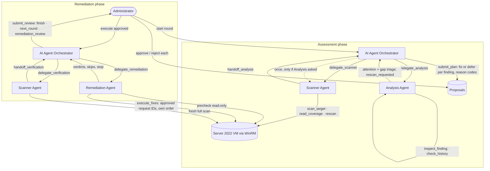

# Agentic framework architecture

Current design as of 1 November 2026. It implements decisions D1–D6 in [AGENTS.md](../../AGENTS.md). Page: **Agentic hardening** (`app.py`). Code: [agentic.py](../../cis_compliance_dashboard_prototype/hardening/agentic.py).

Every role is a bounded local-LLM tool loop (`qwen3:8b`). It chooses its own tool calls, observes the results and acts on them (D6). PowerShell scripts are the agents' tools. Deterministic code does three jobs: it computes compliance and risk (D2), it validates every call, and it enforces approval.

## Who decides what

| Role | Tools (validated by code) | Decides | Cannot |
| --- | --- | --- | --- |
| AI Agent Orchestrator, assessment phase | `delegate_scanner`, `delegate_analysis`, `submit_plan` | Delegation order. Whether to send the Scanner back **once**, only when Analysis requested a rescan or the Scanner stopped without handing off (a stopped Scanner is reported as `scan_not_handed_off`, never as a collection failure, and its delegation result says `retry_allowed`). **Which fixes to propose, in what order, and why each other fixable finding waits.** | Scan, score, approve, execute. Fix a gap, use an action outside the library or the finding's list, fix a blocked finding, leave a fixable finding undecided, give a reason that contradicts the analysis. |
| AI Agent Orchestrator, remediation phase | `delegate_remediation`, `delegate_verification`, `submit_review` | Next step: `finish`, `next_round` or `remediation_review` (report Figure 4.4), with a fact-checked reason code | Decide before verifying executed fixes. Finish while a fix failed, is uncertain or was not attempted. |
| Scanner Agent | `scan_target`, `read_coverage`, `inspect_observation`, `rescan`, `handoff_analysis` / `handoff_verification`, `report_failure` | When to scan. Whether coverage is acceptable. Whether to rescan once (Error results only). | Change settings or send anything but the fixed collector |
| Analysis Agent | `score_findings`, `inspect_finding`, `check_history`, `submit_analysis` | What to investigate (at most 2 investigations). **Which findings need your attention first** (≤ 3). **How to triage every gap:** rescan, resolves with a prerequisite, or manual review. | Change any factor, score or level (D2). There is no tool that could. |
| Remediation Agent | `list_approved`, `precheck`, `execute_fixes`, `skip_fix`, `stop_execution`, `report_results` | Order of execution among approved requests. **Execute or skip each one** after observing the VM. **Whether to continue after a failure:** execution pauses after a failed result and shows its cause, and the agent continues (`execute_fixes`) or stops (`stop_execution`, available only after a failure). | Act on an unapproved request, execute before a precheck or when the precheck shows it is not ready (a list containing one unready request executes nothing), continue after an uncertain outcome, choose values, retry |
| Administrator | Dashboard | Approve or reject each proposal. Fall back to execution without AI. | — |

**One decision per finding.** `submit_plan` takes a single list `decisions`, with one entry per `must_decide` finding: `fix` (with `action_id` and a fix code) or `defer` (with a defer code). Code ranks the fixes by risk score, highest first, ties by control ID, whatever order the Orchestrator lists them in (since 7 November 2026; before, its listed order was the rank). A fix that waits for a prerequisite cannot be in the plan, so no order between fixes is needed for safety.
- Until 31 October the plan was two lists, `fixes` and `skipped`, that must not overlap. Real `qwen3:8b` repeatedly put findings in both: the 29 October J1 runs, the 30 October regression and goal runs, and the real VM on 31 October.
- One list cannot express that conflict; a second entry for the same finding is refused by name.
- A deferral that code already handles never fails the plan: a finding with nothing to decide is ignored.
- **Strict on what can lead to a write, lenient on what cannot (1 November).** A fix is always checked: its action and its reason code. A deferral proposes nothing, so it never fails the plan. A deferral whose code is not a true defer code, and a finding the plan leaves out, are recorded as `not_decided` ("Not decided by the Orchestrator this round; deferred by code") and named in the round summary, so the administrator sees which findings the Orchestrator did not decide. `not_decided` is written by code only and never offered to the model. Reason: after the one-list redesign, real qwen3:8b still failed the `lab` plan by leaving out 1.1.3 and 18.10.57.3.9.4 and by giving `low_impact` as a defer code (31 October, `20261031_010516` and `20261031_013118`).

**Only valid tools are offered.** At each step an agent is shown only the tools that are valid in its current state. For example, the Analysis Agent sees only `score_findings` first and only `submit_analysis` once its investigations are used up. The Orchestrator sees `submit_plan` only after analysis. Code still validates every call, offered or not.

**Budgets.** Each phase has 600 s, NFR06's 10 minutes. Within that, the Scanner has 180 s, the Analysis Agent 220 s and the Remediation Agent 360 s. A single model request is capped at 120–240 s depending on the role (the Scanner's was 60 s until a cold first request timed out in the 27 October check). These numbers come from real-model measurements on the RTX 3050 (4 GB) laptop. `qwen3:8b` does not fit entirely in VRAM, and each switch between agents evicts Ollama's prompt cache, so one request costs about 15–40 s, and the Orchestrator's 12-fix plan up to about 190 s. Ollama keeps only about 2.3 GB of the 6 GB model on the GPU, so *generating* text is the slow part (a few tokens per second), and a call that code must refuse costs real time. That is why the tools return compact results, only valid tools are offered, and the Remediation Agent executes a list per call and names requests by control ID (one proposal per control per round) instead of 32-character request IDs. Writing twelve of those IDs took longer than the request budget.

A rejected call has no effect and names the exact problem, so the model can correct it once. Two invalid calls end that agent's run. The Orchestrator's assessment phase gets three, so it can correct its plan a second time (31 October). Two tolerances, both without effect on the VM or on any score:

- An agent that answers with no tool call before its terminal decision gets **one reminder** listing its valid tools.
- In a plan, a *skip* entry for a control with nothing to decide (a gap) is ignored and recorded in the round summary. A *fix* for such a control is still refused.
- `submit_analysis` has one list parameter per attention code, and each offers only the findings that code fits (since 27 October; a shared control list and code list let qwen3:8b pair audit controls with `manual_fix_needed`). Flags are kept most specific code first (`regression`, `unblocks_other`, `manual_fix_needed`, `high_risk`), and a control listed under several codes is shown once. An attention flag that still does not fit the facts is discarded and recorded (`discarded_flags`), never shown. Fitting flags beyond 3 are dropped and noted. Gap triage stays strict. Attention is advisory and changes no number, and refusing the whole decision for one wrong flag lost the analysis in the 26 October evaluation.
- `delegate_analysis` may name the scan it hands over (by `framework_run_id` or `evidence_sha256`), but only the current one.

Both came from real-model probes. Repeating an identical call is blocked, except for calls a role declares repeatable and bounds itself: `delegate_scanner`/`delegate_analysis` for the one permitted re-delegation, a second `precheck`, and the Scanner's `read_coverage`/`inspect_observation` after a rescan, since those return new data.

## Reasons are codes, not prose

In an earlier trial, free-text reasons were invented: the model justified the anonymous-access fix with "remove unused services". So every agent decision now carries a fixed **reason code**. Code checks the code against the facts, and code writes the sentence the administrator reads. Each agent is shown only the codes that are true for each item, and a contradicting code is rejected with the true ones listed.

| Agent | Codes | Fact that must hold |
| --- | --- | --- |
| Orchestrator plan, fixes | `high_risk`, `unblocks_other`, `improves_detection`, `low_impact` | High/Critical level; another finding waits on this control; audit/logging control |
| Orchestrator plan, skips | `waits_for_prerequisite`, `needs_review`, `lower_priority`, `keeps_reverting`; code only: `not_decided` | A prerequisite is not compliant; the control went from Compliant back to Non-Compliant at least twice in this VM's stored scans. `not_decided`: the plan left the finding out, or deferred it with a code that does not fit |
| Analysis attention | `keeps_reverting`, `regression`, `high_risk`, `unblocks_other`, `manual_fix_needed` | Reverted at least twice **and** the agent checked that control's history itself (the fact is shown only by `check_history`); D = 5; High/Critical; a finding or gap depends on it; no library action |
| Analysis gap triage | `rescan`, `resolves_with_prerequisite`, `manual_review` | Status is Error; the gap is a lockout timer left unrecorded while the threshold is 0 |
| Remediation skip | `precondition_changed`, `prerequisite_not_met`, `expired`, `stop_after_failure` | Fresh precheck observation; an earlier result in this task failed |
| Orchestrator review | `finish`: `all_verified`, `nothing_fixable`, `nothing_executed`. `next_round`: `unblocked_findings`, `remaining_findings`. `remediation_review`: `verification_failed`, `uncertain_outcome`, `remediation_incomplete` | Receipt verdicts plus the verification rescan. `finish` and `next_round` require no failed, uncertain or unattempted fix. |

As a result, every reason shown to the administrator is true by construction. The choices themselves stay with the models: what to investigate, what to flag, what to fix, what to skip, and what happens next.

## Administrator goals (removed 6 November 2026)

From 30 October to 6 November the administrator could type a free-text goal for a round, which the Orchestrator translated into constraints (`interpret_goal`, codes `serves_goal` and `outside_goal`). It was removed on 6 November because its results were too inconsistent: in the evaluation, about half of the goal rounds had their plan refused for format errors, and end to end it did no better than a keyword rule (see [AGENTIC_ASSESSMENT.md](../evaluation/AGENTIC_ASSESSMENT.md#administrator-goals-added-30-october)). Rounds now always run without a goal. Older stored rounds may still carry a `goal` field; nothing reads it. The original design is kept in [archive/ADMIN_GOALS_DESIGN.md](../archive/ADMIN_GOALS_DESIGN.md).

## Fallbacks (report Section 4.1.2)

- **Model unavailable during assessment:** once a scan is collected, the deterministic ranking is still computed and shown. If only the Analysis Agent fails, the Orchestrator still plans from the same ranking. If the model is unavailable from the start, no agentic round runs: the Orchestrator starts every agentic round, so the round is stored as *incomplete* with nothing collected or changed. **Assess without AI** still runs a read-only deterministic scan and computes the same ranking, with no agent decisions and no proposals.
- **Agents stop during remediation:** remaining approvals stay open. The administrator may choose **Execute remaining approved fixes without AI**. That path makes one read-only precheck, as the Remediation Agent must, then runs the same executor in rank order. A request whose value changed since approval, or whose prerequisite is not compliant, is closed unexecuted, as the agent's `skip_fix` would close it. It stops after an uncertain outcome. If the VM cannot be prechecked, nothing runs and every approval stays open.
- **A possible write is never left unobserved:** if any fix was executed and no verification rescan happened, code runs the rescan itself.

Optional FR17 explanation: **Explain with local AI** on a ranked finding (`explain_finding`). It is text only and cannot change any number.

## Risk engine

`R = 6I + 5E + 4P + 3L + 2D`, from 20 to 100. Low is below 40, Moderate 40–59, High 60–79, Critical 80 and above. Ties are ordered by control ID.

- **I, P, L:** derived by rule, never assigned. Each control records attributes from its benchmark entry: a consequence category, a privilege scope, and its profile level plus assessment status. Fixed rules based on report Table 4.15 map these to I, P and L. The rule tables, the derivation for all 32 controls and the stated limitations are in [RISK_DERIVATION.md](RISK_DERIVATION.md), generated from the code. L = 4 for every selected control (all are Level 1 and Automated). Example: `1.2.2` = I4, E3, P4, L4, D1 = **69**, or **77** after a confirmed regression. This replaces the report's illustrative 62/70.
- **E:** set by the control's exposure surface (Table 4.14b): network logon 3, anonymous network 4, firewall 4, RDP 4, local account 3, local secret 2, detection 2. Add 1 when the collected *effective* Public firewall is disabled. If a policy is Not configured but its protection is effectively on, E = 1. A NAT lab never claims internet exposure.
- **D:** from the newest comparable earlier run of the same target (Table 4.14e): 1 when there is no history, 3 when the control was already non-compliant, 5 when it regressed. A scan that the Scanner's own rescan replaced within the same round is not an earlier assessment (each assessment round stores its `scanned_runs`). Until 1 November it was counted, so every finding of a round with a rescan got D = 3 instead of 1 (`error_gap`: 1.2.2 scored 73 instead of 69).

## History and configuration drift

[history.py](../../cis_compliance_dashboard_prototype/hardening/history.py) covers report FR12/FR13, UC07 and Section 4.6.4. After every scan (assessment, rescan and verification), each control is compared with the same VM's previous assessment. Each change is stored once as an immutable ConfigurationDrift record: previous run, current run, control, before/after value and kind (Regression, Improvement, Changed, or a status transition such as `Unknown -> Compliant`). Two results are comparable only when the control's benchmark citation, profile, rule and collection method are identical. Evidence collected live over WinRM is stored as `Live` and an uploaded file as `Imported`; both come from the same collector and evidence contract, so they are comparable with each other (only the transport differs). The same rule feeds D. The **History and drift** page lists assessments and drift records and compares any two runs.

## Pre-approved remediation library

The library is defined in two places that must agree: the Python metadata in [action_library.py](../../cis_compliance_dashboard_prototype/hardening/action_library.py) and the fixed implementations in [Invoke-RemediationAction.ps1](../../scripts/vm/Invoke-RemediationAction.ps1). `LibraryParityTests` checks that they match.

| Action | Control | Implementation |
| --- | --- | --- |
| REM-1.1.1 / 1.1.2 / 1.1.3 / 1.1.4 | Password history 24 / max age 365 / min age 1 / min length 14 | `net accounts` with a constant option |
| REM-1.2.2, REM-1.2.1, REM-1.2.4 | Lockout threshold 5; duration 15 and reset 15 | `net accounts`. 1.2.1 requires 1.2.2 compliant; 1.2.4 requires 1.2.2 and 1.2.1 |
| REM-2.3.1.1 | Disable Guest (SID RID 501) | `Disable-LocalUser -SID` |
| REM-2.3.1.2, REM-2.3.10.2, REM-2.3.10.3 | LSA DWORDs = 1 | 64-bit registry `SetValue` |
| REM-17.1.1, 17.2.2, 17.2.3, 17.5.1, 17.5.4 | Advanced audit subcategories | `auditpol /set /subcategory:{GUID}` that only *enables* the required flags |
| REM-18.10.57.2.2, 3.9.1, 3.9.3, 3.9.4 (NLA), 3.9.5 | RDP policy values (also fixes a "Not configured" policy) | 64-bit registry `CreateSubKey` + `SetValue` under `Policies\…\Terminal Services` |
| REM-9.2.6, 9.2.7, 9.3.6, 9.3.7 (added 6 November) | Firewall **logging** on the Private and Public profiles: log dropped packets, log successful connections = 1 (also fixes a "Not configured" policy) | 64-bit registry `CreateSubKey` + `SetValue` under `Policies\Microsoft\WindowsFirewall\<Profile>\Logging`, the same path the collector reads |

That makes 25 actions for 32 controls. Assessment-only: `1.1.5` and `1.1.7` (need `secedit /configure`), `2.3.10.1`, and the four firewall controls that decide **which traffic is allowed**: `9.2.1`/`9.3.1` (firewall on) and `9.2.2`/`9.3.2` (inbound: Block). Those writes could cut the agents' own WinRM channel, so they wait for a channel-safety precheck. The logging actions only record traffic and never change what is allowed, so they cannot cut the channel. A test in each language (`LibraryParityTests.test_no_action_can_change_which_traffic_the_firewall_allows` and `test_remediation_runner.ps1`) fails if any action targets those four controls or writes firewall policy outside `…\Logging`.

**Decision D5, "Not configured" policy.** An absent firewall or RDP Group Policy value is Non-Compliant. For a library action, the approved precondition is then `null` ("still not configured"). The VM runner accepts `null` only for registry actions.

## Remediation guarantees

These hold whether the Remediation Agent or the no-AI fallback runs the action:

- An approval is bound to the exact request bytes: target, control, action, value and observed before-value. It expires after 1 hour, and each proposal gets one decision. The administrator's optional comment is stored apart from the decision (`rem_comments`, append-only), so it never changes the bytes the VM runner checks by hash.
- The Remediation Agent must precheck before executing. A request whose value changed, whose prerequisite is not met or whose approval expired can only be skipped. Skipping records a refusal, so a stale approval can never run later.
- Inside the VM, before any write, the runner checks identity (hostname, UUID, admin token), the request hash and library contract, expiry, and a fresh precondition read. It then makes a `CreateNew` ledger claim, makes exactly one write, and re-collects the evidence.
- Python verifies the receipt with the same collector and rule. A command that ran is not a verified control.
- An uncertain outcome (channel lost, or a receipt that fails validation) is recorded as unresolved. The Remediation Agent must then stop, and the Orchestrator can only choose remediation review. A failed verification never triggers an automatic second write.

## Evidence

- `tests/test_agentic.py`: the full loop with a simulated VM and scripted or responsive test doubles.
  - Analysis: investigation and flags, codes that contradict facts, a failed Analysis Agent (ranking survives), a rescan request sending the Scanner back once.
  - Remediation: skip of a changed request, no execute before precheck or on unapproved IDs, stop after an uncertain outcome.
  - Review: fact-checked next-step codes, unblocked findings leading to a new round, Orchestrator outage, no-AI fallback.
  - Executor guards, risk arithmetic, and library parity with real PowerShell.
- `tests/test_agentic_view.py`: page walkthrough covering round, approve, reject, execute, verification and next step.
- `scripts/evaluation/probe_agentic_round.py`: real `qwen3:8b` for all four roles against the simulated VM. Results are recorded in [PROGRESS.md](../../PROGRESS.md).
- Real VM: one session on 30 October (two assessment rounds; 1.2.2, 1.1.1 and 1.1.3 approved, executed and verified compliant). See [PROGRESS.md](../../PROGRESS.md).

## Assessment run register

[framework.py](../../cis_compliance_dashboard_prototype/hardening/framework.py) `AssessmentRuns` records every scan as one immutable run bound to its validated evidence snapshot and target. It has no agent, model or VM access. `python -m hardening.framework` is the non-UI client (evaluation E02): it assesses an evidence file or prints a stored run with its deterministic ranking.
