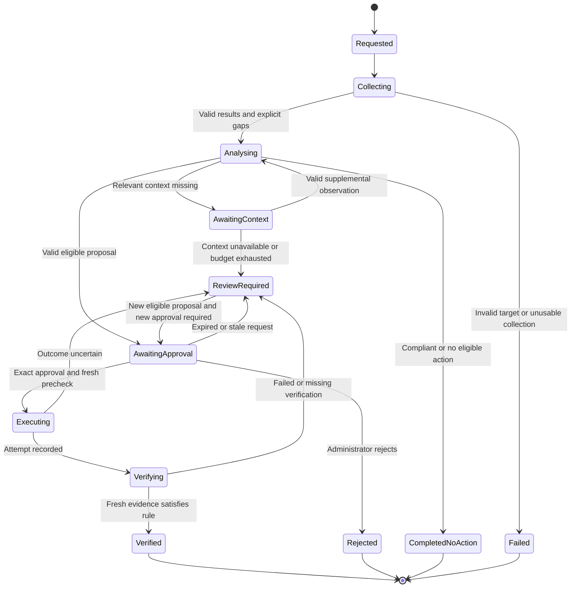

# Complete project requirements and report coverage

> **Status, 1 November 2026: requirement text current; the implementation-evidence table and the FR/NFR status columns were brought up to date on 1 November.** The 36-control register below is the report's original candidate list; the delivered catalogue is 32 Stand-alone v2.0.0 controls ([BENCHMARK_MAPPING.md](../design/BENCHMARK_MAPPING.md)). Design: [ARCHITECTURE.md](../design/ARCHITECTURE.md). Progress: [PROGRESS.md](../../PROGRESS.md).

Reviewed on **22 October 2026, Asia/Kuala_Lumpur** against `RIS_KhooTengYi_Report.docx`, SHA-256 `8ee4293978a456ea6c2f51532afc475ef8a5813b9cbef47f1f980df256074a75`.

The project target is an **Agentic AI Framework for Windows Systems Hardening and CIS Compliance Assessment**: a reusable, locally operated framework that assesses one Windows Server 2022 target, explains and prioritises findings, supports administrator-approved remediation, verifies changes, and detects configuration drift. The working assessment target is the report's 36 candidate controls, with a stated minimum of 30; five reviewed checks and one executable action are the demonstrated preview scope. Full report coverage in documentation does not mean full implementation.

This document completes the requirements detail behind [REPORT_ALIGNMENT_PLAN.md](REPORT_ALIGNMENT_PLAN.md), which remains the agreed architecture and milestone plan. [REPORT_ORIGINAL_TEXT.md](REPORT_ORIGINAL_TEXT.md) preserves the supplied report's complete body text and table text, including the original seven objectives, original requirements, rubric descriptions, schedule, data dictionary and references. Its figure markers point back to the unchanged Word report; the figure review below records their design meaning. These Markdown files do not reproduce Word pagination or embedded image pixels.

## How to use this documentation

Jump to [objectives and scope](#agreed-objectives-and-scope), [functional requirements](#functional-requirement-traceability), [quality and technical requirements](#quality-and-technical-requirement-traceability), [use cases](#use-cases-and-observable-outcomes), [36 controls](#complete-36-control-candidate-register), [evaluation](#development-programme-and-evaluation), [open decisions](#outstanding-report-revisions-and-decision-register), or the [complete section index](#complete-report-section-coverage-index).

| Question | Authoritative project document |
| --- | --- |
| What are we trying to build and what must be covered? | This document, particularly objectives, requirements, catalogue, evaluation and coverage index |
| What architecture and next milestones have been agreed? | [Report alignment and framework plan](REPORT_ALIGNMENT_PLAN.md) |
| What did the original report actually say? | [Original report text and tables](REPORT_ORIGINAL_TEXT.md); original DOCX for figures/layout |
| What is implemented, tested or currently being worked on? | Latest dated handoff in [PROGRESS.md](../../PROGRESS.md), supported by source and validation records |
| How do I run the current application? | [README.md](../../README.md) |
| What benchmark rules are actually reviewed? | [BENCHMARK_MAPPING.md](../design/BENCHMARK_MAPPING.md) |
| How do we collect evidence and execute an approved lab action? | [VM_EVIDENCE.md](../archive/legacy/VM_EVIDENCE.md) and [VM_BRIDGE.md](../archive/legacy/VM_BRIDGE.md) |
| What has been demonstrated on the actual VM or actual local model? | [FIRST_VM_IMPORT_VALIDATION.md](../evaluation/FIRST_VM_IMPORT_VALIDATION.md) and [docs/archive/LOCAL_MODEL_VALIDATION.md](../archive/LOCAL_MODEL_VALIDATION.md) (synthetic preview era) |

**Interpretation rule:** explicit user decisions take precedence over older plans. Preserve the original report for traceability; record a revision instead of silently rewriting its meaning. A report requirement describes a target, a source file establishes that code exists, and a validation record establishes only what that specific test demonstrated. Older preview schedules and sample screenshots are historical.

This review was authorized to edit Markdown only while another development run held the cooperative lock. Application code, the original DOCX, benchmark files and VM settings were not changed. F1 work was in progress during inspection; its final completion status belongs to its own validation handoff.

## Purpose and project context

Report coverage: Abstract and Sections 1.1, 1.3, 1.5, 1.6, 1.7 and Chapter 2.

The problem is the repeated manual work of collecting Windows security settings, interpreting compliance failures, deciding what to fix, and checking whether changes actually worked. The intended contribution is an integrated workflow with reproducible security decisions, bounded AI assistance and an auditable administrator decision. Evidence must demonstrate this contribution; naming scripts after agents is insufficient.

The intended users are small and medium enterprises, educational institutions, internal IT teams, and training/research users. These are intended audiences, not evidence of production deployments or completed user studies. The initial delivery and evaluation environment remains a controlled single-server lab.

The report's feasibility argument relies on existing Windows tools, PowerShell, Python, SQLite, Streamlit, local Ollama and Qwen3-8B, with iterative implementation to limit complexity. Local processing reduces dependence on cloud inference. Financial feasibility is qualitative: the report supplies no measured total cost or approved purchasing budget. Windows licensing, hardware capacity and actual runtime resource use should be recorded for the evaluation environment rather than described as free or guaranteed.

The report identifies Khoo Teng Yi as Windows project researcher/developer, Teoh Kai Hong as responsible for the Linux project, and Ms Lim Mei Shyan as supervisor at TAR UMT. The separate Ubuntu prototype does not expand this Windows implementation's supported platforms.

### Research basis and contribution limits

The following summarises the report's research rationale; it is not a new external literature audit. Full citations and comparison tables are retained in the source reference.

| Report area | Design implication | Evidence still needed for the project's own claim |
| --- | --- | --- |
| Windows hardening and security baselines, 2.1–2.1.2 | Use reviewed, versioned secure configuration rules | Exact selected-edition source mapping and independent manual agreement |
| Manual checks, Microsoft SCT, Nessus/Tenable, OpenSCAP and Greenbone/OpenVAS, 2.2 | Integrate assessment, interpretation and controlled follow-up | Do not infer that competing products lack features from a brief comparison table |
| CVSS, EPSS and contextual prioritisation, 2.2.1 | Explain the rationale for configuration-specific prioritisation | The project score is not CVSS, an EPSS probability, or a CIS-defined score |
| LLMs, agentic AI, multi-agent systems and tool use, 2.3.1–2.3.3 | Retain goals, bounded tools, observations, state and handoffs | Actual meaningful adaptive traces, compared with a fixed workflow |
| AI-assisted analysis and remediation, 2.3.4–2.3.5 | Ground explanations in evidence and restrict action candidates | Unsupported-claim review, approval bypass tests and unavailable-model behaviour |
| Drift, 2.3.6 | Compare compatible immutable snapshots | Regression, improvement, unchanged, missing-history and incompatible-history cases |
| Research gap, 2.4 | Demonstrate the integration of these functions within the selected Windows scope | A working evaluated integration; no unsupported claim of being the first or universally better system |

## Agreed objectives and scope

The user accepted these three consolidated objectives on 22 October 2026. The original seven objectives remain in the source report and are mapped here without removing their substance.

1. **N1 Framework and assessment:** develop a modular agentic AI framework coordinating Scanner, Analysis and Remediation Agents through evidence-based investigation and task delegation, using predefined rules to assess selected Windows Server configurations.
2. **N2 Analysis and decision support:** support administrator decisions through deterministic risk prioritisation, AI-assisted explanations and configuration drift detection, presenting findings and historical results through Streamlit.
3. **N3 Controlled remediation and verification:** enable review, approval or rejection of predefined remediation actions, then reassess affected configurations to determine whether approved changes achieved the required settings.

| Original objective | Consolidated objective | Requirements retained |
| --- | --- | --- |
| O1 Scanner collection and assessment | N1 | FR01–FR04 |
| O2 Analysis, prioritisation and explanations | N2 | FR05–FR07, FR17 |
| O3 Controlled remediation | N3 | FR08–FR10, FR15 |
| O4 Orchestration | N1, supporting N2/N3 | FR16 |
| O5 Verification | N3 | FR11 |
| O6 History and drift | N2 | FR12–FR13 |
| O7 Dashboard | N1–N3 presentation, principally N2 | FR14 |

**Included:** one registered Windows Server 2022 target; selected CIS-aligned checks in Account Policies, Local Security Options, Windows Defender Firewall, Advanced Audit Policy and Remote Desktop Services; four logical application roles; deterministic assessment and risk; local model assistance; a reviewed remediation subset; explicit approval/rejection; verification; SQLite history/drift; Streamlit presentation; functional, safety, performance and usability evaluation.

**Excluded:** the complete CIS Benchmark; Active Directory/domain policy assessment; network vulnerability scanning; third-party application vulnerability assessment; enterprise multi-server/client management; SIEM/ticketing integration; unrestricted generated commands; unapproved writes; model training; remediation of every assessed control. No laptop hardening is part of this project. A future transport adapter or per-device path preference does not itself establish additional OS or multi-server support.

**Control-count decision:** retain all 36 report candidates as the working target. The report also promises a minimum of 30. A reduction to 30–35 needs an explicit recorded scope decision identifying omissions and rationale; do not quietly count unsupported or unreviewed rows as implemented. Assessment coverage and remediation coverage are separate measures.

**Benchmark decision:** the report names Server 2022 v5.1.0. The current lab catalogue is `cis-server2022-standalone-2.0.0-full1` (32 controls), based on the reviewed Stand-alone v2.0.0 PDF and its exact profile label `Level 1 - Member Server`. Do not copy candidate identifiers or values into executable rules without reconciling the selected edition, role and applicability. The name of that profile does not change the registered lab's standalone role.

## Implementation evidence at this review

Updated 1 November 2026. "Real VM" means the registered lab VM `WIN-VFT30DUDRHQ`; "simulated" means the fixture VM used by the tests and the real-model evaluations.

| Capability | Evidence level | Remaining final-scope work |
| --- | --- | --- |
| 32 Stand-alone v2.0.0 controls | Source-reviewed catalogue; collector v5 collected all 32 on the real VM (30 Oct), including the 5 audit values | Independent comparison on the VM (runbook Part C, `cross_check_controls.py`) and the secpol.msc check of 1.1.5, 1.1.7, 2.3.10.1 |
| 21 library actions | Exact request binding, 1-hour expiry, one-attempt VM ledger, fresh precondition read; 3 actions verified on the real VM (1.2.2, 1.1.1, 1.1.3) | The other 18 actions are verified on the simulated VM only |
| Four LLM agents | Orchestrator, Scanner, Analysis and Remediation tool loops on real qwen3:8b; 20-run and later evaluations on the simulated VM; one real-VM session | Plan-step reliability (see AGENTIC_ASSESSMENT); a real-VM drift round |
| Risk and drift | Rule-derived I/P/L for all 32 controls; E from collected context; D from comparable history (rescans within a round excluded since 1 Nov) | User review of the attribute assignments (RISK_DERIVATION.md) |
| Dashboard | Overview, Agentic hardening (5 tabs), History and drift; downloadable round report | Supervisor walkthrough (E08); report screenshots |
| Transport | WinRM over a loopback NAT forward, NTLM with message encryption; the shared-folder exchange was retired | — |
## Functional requirement traceability

These descriptions summarise FR01–FR17; exact source wording is retained in [Section 3.2.3](REPORT_ORIGINAL_TEXT.md#report-section-3-2-3). No row is marked complete for the full final scope. `Partial` indicates usable foundations or limited-scope evidence; `Planned` means the required real workflow is not established by this review.

| ID | Required behaviour | Objective and use case | Owner and current status (1 Nov 2026) | Completion evidence |
| --- | --- | --- | --- | --- |
| FR01 | Collect configuration values for selected controls | N1 / UC01 | Scanner Agent over WinRM; **done**: 32 controls collected on the real VM | Independent VM comparison still to run (E01) |
| FR02 | Compare observed values with predefined rules | N1 / UC01 | Evaluator; **done**: typed operators equals, at_least, between, has_flags | Boundary and type tests in the suite |
| FR03 | Classify assessment outcomes | N1 / UC01 | Evaluator; **done**: Compliant, Non-Compliant, Unknown, Error; "Not configured" policy is Non-Compliant (D5) | Report FR03 wording to update (REPORT_REVISIONS A3) |
| FR04 | Record observed/expected values, outcome and assessment metadata | N1 / UC01 | Storage; **done**: immutable snapshot with target, catalogue, source, time and evidence mode | Append-only tables refuse update/delete |
| FR05 | Pass non-compliant findings to Analysis Agent | N2 / UC02 | Orchestrator `delegate_analysis`; **done** | Agent traces in every round |
| FR06 | Compute deterministic risk for non-compliant findings | N2 / UC03 | Risk engine; **done**: rule-derived I/P/L, E and D | User review of attributes pending |
| FR07 | Classify and prioritise scored findings | N2 / UC03 | Risk engine; **done**: levels 39/40, 59/60, 79/80; ties by control ID | Boundary tests |
| FR08 | Recommend library actions for a defined remediable subset | N3 / UC04 | Orchestrator plan from 21 actions; **done** | Firewall actions excluded for channel safety |
| FR09 | Require administrator approval before changes | N3 / UC05 | Approval store; **done**: exact binding, expiry, one decision, optional comment | 0 unapproved writes in every evaluation |
| FR10 | Execute an applicable approved predefined action | N3 / UC05 | Remediation Agent and VM runner; **done**: 3 actions on the real VM | Remaining actions simulated only |
| FR11 | Reassess affected control after remediation | N3 / UC06 | Scanner verification rescan; **done** | Real VM 30 Oct: 3/3 verified |
| FR12 | Store assessments, risk, actions, verification and drift | N2/N3 / UC08 | SQLite stores; **done** | — |
| FR13 | Compare current and previous comparable assessments | N2 / UC07 | History service; **done** on simulated data | Real-VM drift test (runbook Part F) pending |
| FR14 | Present compliance, risk, remediation, verification and history | N1–N3 / UC08 | Streamlit; **done** | Supervisor walkthrough pending |
| FR15 | Allow review of findings and proposed changes | N3 / UC04/UC05 | Fixes tab and execution confirmation; **done** | — |
| FR16 | Coordinate specialised roles according to workflow state | N1 / all UCs | AI Agent Orchestrator; **done, reliability limited**: plan-step refusals on real qwen3:8b | AGENTIC_ASSESSMENT records the measured limits |
| FR17 | Explain non-compliant findings understandably | N2 / UC02/UC08 | **Explain with local AI** (labelled unverified); **done** | Explanation quality not evaluated |

## Quality and technical requirement traceability

Original wording: [Section 3.2.4](REPORT_ORIGINAL_TEXT.md#report-section-3-2-4) and [Section 3.2.5](REPORT_ORIGINAL_TEXT.md#report-section-3-2-5).

| ID | Requirement | Verification and current limitation (1 Nov 2026) |
| --- | --- | --- |
| NFR01 | Only approved predefined configuration changes | Met: 0 unapproved writes across every evaluation and the real-VM session |
| NFR02 | Consistent deterministic compliance and risk | Met: deterministic engine; a D-factor error after same-round rescans was fixed on 1 Nov |
| NFR03 | Clearly labelled results usable without reading database rows | Built; supervisor walkthrough (E08) pending |
| NFR04 | Structured reliable local storage/retrieval/history | Met: append-only SQLite with integrity checks |
| NFR05 | Independently maintainable modules | Met: layers separated; non-UI client `python -m hardening.framework` |
| NFR06 | Assessment and verification within 10 minutes | Met on the real VM (assessment 342 s and 390 s, remediation 139 s) and in the simulated evaluations |
| NFR07 | Original: LLM supports interpretation/explanation, cannot execute changes or determine numeric scores | Met in substance; the report wording must change to bounded tool selection (REPORT_REVISIONS A2) |
| NFR08 | Local processing without required external cloud service | Met: loopback Ollama only; no cloud fallback |
| STR01 | Windows Server 2022 target | Met: standalone Server 2022 build 20348 VM |
| STR02 | PowerShell collection and approved changes | Met: fixed collector and runner |
| STR03 | Python framework and workflow | Met |
| STR04 | Local LLM for interpretation/explanations | Met: Ollama qwen3:8b; report wording to update (A2) |
| STR05 | Local persistent database | Met: SQLite |
| STR06 | Web-based result dashboard | Met: Streamlit |
| STR07 | Sufficient resources for server, application, database and LLM | Recorded: RTX 3050 4 GB laptop; about 2.3 of 6 GB of the model on the GPU |

## Use cases and observable outcomes

Administrator is the primary external actor. Scanner, Analysis, Remediation, Orchestrator and database are internal participants. Each case inherits registered target, fixed selected scope, versioned rules and honest provenance. The more detailed Figure 4.2 label mapping remains in the alignment plan.

| ID | Trigger and preconditions | Main flow and postcondition | Alternatives that must be documented and tested |
| --- | --- | --- | --- |
| UC01 Perform Security Assessment | Administrator requests assessment; target/scope known and collector access available | Create run; collect/import; validate identity and values; evaluate every selected control; persist results and coverage | Wrong target, invalid payload, failed/missing observation, unsupported role; no silent removal of selected controls |
| UC02 Analyse Non-Compliant Findings | Valid non-compliant results exist | Durable Analysis task; examine evidence/reference/context; produce supported explanation and missing-context outcome | No findings, AI outage, malformed tool request, inadequate context; preserve deterministic results |
| UC03 Calculate and Prioritise Risk | Reviewed baseline and E/D inputs available | Compute five factors deterministically; store score/rationale/version; rank findings | Missing factor yields unavailable score, not fabricated ranking; compliant/error results excluded |
| UC04 Review Remediation | Applicable supported finding and action candidate | Show observed/expected values, target, evidence time, risk or unavailable reason, fixed action, parameters and operational impact | Unsupported action, missing prerequisite, no change needed or stale evidence; withhold executable request |
| UC05 Approve and Execute Remediation | Review completed; exact proposal eligible | Store administrator decision; if approved, validate binding and fresh preconditions; execute once; record attempt | Reject/cancel/expire/duplicate/wrong target/changed precondition: no write; uncertain execution: observe/review, never blind retry |
| UC06 Verify Remediation | An execution attempt has a matching request and target | Collect fresh affected setting, run original rule and persist separate verification; show verified/unresolved outcome | Unchanged setting, missing/error read-back or mismatched receipt is not success; retry requires a new attempt and approval |
| UC07 Detect Configuration Drift | New result and compatible earlier history exist | Compare actual values/statuses; retain both snapshots; record regression/improvement/change | No history, different target/version/profile, unknown/error observation: do not infer regression |
| UC08 View Dashboard | Current test or explicit historical selection exists | Display required views, evidence mode, scope, coverage, status and linked audit trail | Blank start, unavailable risk/AI, incomplete scan and no history must remain understandable |

## Framework architecture and workflow contract

Keep the four role definitions, architecture diagram, typed contracts and F0–F6 milestones in the alignment plan. One local model is sufficient; policy-driven operational roles are not independent LLMs. The reusable runtime owns workflow state; Streamlit is a client. SQLite and history are services, not extra agents.

| Role/component | Required responsibility | Boundary |
| --- | --- | --- |
| Scanner Agent | Complete selected collection/evaluation and scoped verification; report gaps | Registered read-only collectors; no configuration writes |
| Analysis Agent | Evaluate context, call deterministic risk/history services and obtain grounded explanations | No invented scores, expected settings or operational context |
| Remediation Agent | Resolve registered candidates, enforce prerequisites, fulfil exactly approved attempt and request verification | No self-approval, free-form PowerShell or automatic second write |
| AI Agent Orchestrator | Retain goal/tasks, delegate roles, react to evidence, request review or stop | Structured requests validated by deterministic controller |
| Risk engine and evaluator | Typed comparison, numerical scoring and classification | Not delegated to model judgement |
| Storage and transport | Durable records and validated request/result exchange | File digest does not provide authenticated device identity; protected worker transport is later design work |

The following is the **target revised state model**, not a claim that all transitions currently exist:

Retain a separate terminal outcome from lifecycle completion. A rejected, unsupported or unresolved workflow can finish without making its target compliant. Read-only supplementary investigation must have step, repeat, request-time and total-runtime bounds. Model or evidence text never authorizes a tool call or changes a permission boundary.

## Assessment and catalogue rules

For each activated control, record edition/profile and source pages, stable ID/title/category, target-role applicability, typed expected value and operator, fixed collection method, explicit policy versus effective-state meaning, missing/error semantics, benchmark rationale, reviewed risk baseline/version, and optional action/verification references. Expected values may be minima or ranges; the report's phrase “matches expected value” must not turn every comparison into string equality.

Current reviewed rules are minimum password length at least 14; lockout threshold between 1 and 5 inclusive; Guest enabled equals false; explicit Public firewall `EnableFirewall` equals 1; explicit NLA `UserAuthentication` equals 1. These are the current catalogue's rules, not an independently verified v5.1.0 mapping. Missing policy observations remain distinct from separately collected effective firewall/NLA context; do not infer disabled protection or compliance from absence alone.

Display selected count, valid assessed count, Compliant, Non-Compliant, Unknown and Error. The project convention is compliance among valid assessed controls, with checked/selected coverage displayed separately; when none is valid, show unavailable compliance. Do not imply five controls represent the whole CIS Benchmark.

### Report control candidate register

The following register preserves all 36 rows from report Table 3.2. Candidate IDs are source claims, not activation authority. `Reviewed preview` refers only to the separate current Stand-alone v2.0.0 mapping; `Candidate` requires source/applicability review, implementation and manual validation. Only minimum password length currently has an executable action. The register follows below with the full source section index.

## Risk and drift specification

Report coverage: Sections 4.6.2.1–4.6.2.5, Tables 4.14–4.17 and 4.6.4. All original factor-specific criteria are preserved in the source reference.

`R = 20 × (0.30I + 0.25E + 0.20P + 0.15L + 0.10D) = 6I + 5E + 4P + 3L + 2D`.

Each factor is an integer from 1 to 5; scores range from 20 to 100. Reject booleans, missing values and out-of-range factors. Calculate only for valid non-compliant findings. The score is a project-defined prioritisation aid, not a probability or an official CIS/CVSS score.

| Factor | Weight | Assignment and required evidence |
| --- | --- | --- |
| I Security Impact | 30% | Researcher-reviewed, versioned per-control baseline, citing rationale/impact and exact rubric choice |
| E Exposure | 25% | Deterministic mapping of observed or explicitly supplied context; record its source; local NLA/firewall settings do not establish external reachability |
| P Privilege Impact | 20% | Reviewed baseline tied to affected privileges, user rights/groups and control rationale |
| L Likelihood | 15% | Reviewed project heuristic; the report proposes using profile/assessment status, but supplies no validated probability model or complete numerical mapping |
| D Configuration State or Drift | 10% | Compatible historical evidence and a documented complete decision rule |

The original D rubric defines 1 for no comparable history, 3 for unchanged persistent non-compliance, and 5 for compliant-to-non-compliant regression. It omits changed-but-still-non-compliant values. The existing development plan extends D=3 to persistent non-compliance including changed values; retain that as an explicit implementation decision. Invalid/incompatible prior evidence cannot establish a regression. Record improvements and other value changes even when they are not scored non-compliant findings.

| Score | Level | Priority |
| --- | --- | --- |
| 20–39 | Low | 4 |
| 40–59 | Moderate | 3 |
| 60–79 | High | 2 |
| 80–100 | Critical | 1 |

Sort by descending score; define a stable tie rule when the ranking implementation is completed. Operational sequencing recommendations may account for dependencies but must not change the numeric score. With I=4, E=3, P=3, L=3 and D=1, R=62; with confirmed regression D=5, R=70. The report's illustrative 62 must not be reused for a record that simultaneously claims confirmed regression.

Baseline review must document the actual chosen integer, supporting source passage, rubric version, reviewer and uncertainty for every assessed control. Broad statements such as “higher score” are insufficient to reproduce assignment. Profile level and automated assessability are not by themselves demonstrated exploitation likelihood; retain this limitation and evaluate the heuristic rather than presenting it as established threat intelligence.

Drift comparison requires target identity, control identity, benchmark edition/profile and compatible evidence meaning. A changed value, an improvement and a compliance regression are distinct outcomes. Preserve previous/current result IDs, observed values, statuses, timestamps and comparison rationale. The real 0-to-14-to-0 lab sequence is a useful evaluation scenario only when each observation is independently retained and comparable.

## Remediation and verification specification

The action registry must state action ID/version, supported control/target, fixed implementation, allowed parameters, prerequisites, before/after rule, impact, recovery guidance and verification method. Unsupported controls remain assessment-only. The LLM may recommend eligible registered action IDs under the revised boundary; the controller determines eligibility, and the administrator grants exact approval.

Persist the proposal, binding to evidence/target/action/parameters, administrator identity and comment, approval/rejection time, expiry, attempt identity, precheck, execution outcome and verification record. Validate all of these at dispatch. Rejection causes no write. A duplicate UI rerun or delayed duplicate file cannot execute twice. Changed preconditions invalidate the old request. A timeout is an uncertain outcome requiring observation/review.

Verification recollects the affected setting and applies the original reviewed comparison. A successful process exit is insufficient. Fresh matching evidence must show compliance; otherwise report failed, unknown or unresolved verification. Preserve the original assessment and show a separate current postcheck. Every additional write requires a distinct attempt with fresh exact approval, even for the same action.

The current password-length action sets the registered VM's minimum to 14. Impact concerns future password-policy enforcement; it is not evidence that existing passwords were changed. Use the current action metadata and [VM_BRIDGE.md](../archive/legacy/VM_BRIDGE.md) for actual prerequisites and procedure. This documentation does not execute a remediation.

## Data design and provenance

Report Sections 4.5.1–4.5.3 and Tables 4.4–4.13 define nine entities. The exact field names, source data types, example values and relationship descriptions are retained in [the source data dictionary](REPORT_ORIGINAL_TEXT.md#report-section-4-5-2). These are the report's logical entities, not a claim that current SQLite files use identical table names.

| Entity | Source fields | Required interpretation or extension |
| --- | --- | --- |
| CISControl | control_id, control_title, security_area, expected_value, benchmark_reference | Add catalogue/edition/profile, typed operator/value, applicability and source provenance |
| ControlRiskBaseline | baseline_id, control_id, security_impact_baseline, privilege_impact_baseline, likelihood_baseline, rationale | Version and review baselines; preserve earlier versions used by historical scores |
| Assessment | assessment_id, initiated_by, start_time, end_time, status | Add registered target, evidence mode, selected scope and catalogue version; completion is not compliance |
| AssessmentResult | result_id, assessment_id, control_id, observed_value, expected_value, compliance_status, assessed_at | UNIQUE assessment/control in source; retain typed source evidence and Unknown/Error reason |
| RiskScore | risk_id, result_id, security_impact, exposure, privilege_impact, likelihood, drift_score, risk_score, risk_level | Optional for a result; store factor sources/rule versions; do not insert invented scores when inputs are unavailable |
| Remediation | remediation_id, result_id, action_name, script_reference, status, executed_at | Model multiple distinct attempts per finding; version action and parameters; no arbitrary script execution from stored text |
| Approval | approval_id, remediation_id, administrator_id, decision, decision_time, comments | Preserve each decision, exact binding and expiry; never overwrite an earlier approval to authorize a retry |
| Verification | verification_id, remediation_id, verified_value, verification_status, verified_at | Bind to execution attempt/request and fresh observation; failed checks remain visible |
| ConfigurationDrift | drift_id, current_result_id, previous_result_id, change_description, detected_at | Same-target/version/profile compatibility, kind of change and stable comparison identity |

Additional framework persistence needs durable run/task/correlation IDs, role/capability, input/output references, task state, public decision summary, errors and terminal outcome. Store public tool traces rather than raw model thinking. Keep imported/live and synthetic records identifiable and separate. Local storage is not proof of production authentication or tamper-proof audit; those guarantees have not been demonstrated.

The report's one-remediation-per-result and one-approval-per-remediation constraints conflict with its description of later retries/new actions unless an explicit attempt model is introduced. Recommended design: finding to many action attempts, each independently bound to its approval and verification observations. Read-only re-verification may retain multiple observations without granting a new write. Schema migration and historical-record preservation need their own implementation validation.

## Dashboard and figure coverage

Keep the normal app's blank/current-test entry. Implement the report's historical information as an explicit separate view, rather than automatically loading an old assessment into the active remediation workflow. No real numeric risk should appear until factor mapping exists. Clearly identify synthetic, imported and live evidence; screenshots in the report are representative mock-ups.

| Report figure | Meaning covered in Markdown | Required alignment or validation |
| --- | --- | --- |
| 4.1 Architecture | Administrator/Streamlit, Orchestrator, three operational agents, local LLM/database, PowerShell and target | Add validated decision interface; separate local host from VM and transport |
| 4.2 Use cases | Eight administrator interactions; detailed mapping in alignment plan and UC table here | Clarify “Dashboard or Reports”; downloadable report export is not an agreed implemented feature |
| 4.3 Sequence | Request, scan/store, analyse/score, propose, approve/reject, execute, verify/store/display | Add missing context/failure paths and exact request/attempt binding |
| 4.4 State chart | Requested, scanning, analysis, risk, awaiting approval, remediation, verification, review and completion | Extend unresolved/failed outcomes and bounded investigation; no automatic write retry |
| 4.5 Class/module diagram | Presentation, orchestration, three roles, risk engine, LLM client, catalogue/baselines and storage | Diagram's baseline class should also appear in module inventory; explanation-only client differs from revised tool interface |
| 4.6 ER diagram | Nine logical entities and linked evidence/approval/verification/history | Resolve retry cardinalities and add target/catalogue/version provenance |
| 4.7 Assessment flow | Loop through selected controls, collect, compare, store, forward failures | Typed comparisons and Unknown/Error branches; retain selected denominator |
| 4.8 Risk flow | Retrieve baselines, explanation, E/D, weighted score, classify and store | Model outage must not block deterministic scoring; missing inputs prevent unsupported score |
| 4.9 Remediation flow | Candidate, review, reject or approve, execute, verify, review failure | Fresh approval per write attempt; preserve original baseline |
| 4.10 Drift flow | Find compatible earlier result, compare values and store change | Compare identity/version/profile, distinguish value change from compliance regression |
| 4.11(a) Overview | Run, scope, compliance, non-compliant count and device situation | Only evidence-backed posture; selected/checked coverage and unavailable risk visible |
| 4.11(b) Readiness and summary | Agent readiness/events, run metadata, risk distribution and assessment snapshot | Replay stays labelled; actual task events replace fabricated activity |
| 4.11(c) Awaiting approval | Assessment/analysis progress and human decision boundary | Completion of analysis cannot authorize execution |
| 4.12 Assessment results | Observed/expected values, compliance and filters | Include Unknown/Error, timestamp, source and baseline |
| 4.13(a) Risk details | Ranked findings, five factors/formula and supporting explanation | Distinguish computed score, factor provenance and model explanation |
| 4.13(b) Decision support | Security consequence, client compatibility and approve/reject impact | Do not carry sample NLA/exposure assumptions into an imported finding without evidence |
| 4.14 Remediation review | Finding, risk, action/script reference, impact, comment, approve/reject | Exact target/request binding, eligibility and unavailable-risk explanation |
| 4.15 Verification results | Action, execution time, read-back/expected value and audit trail | Failed/unknown outcomes visible; only fresh evidence establishes verified success |
| 4.16 Drift and history | Prior/current values, change time and assessment history | Explicit history navigation; historical result cannot be reused as current authorization |

Figures 4.1–4.10 were visually inspected from embedded images during this review. All figure captions and accompanying narrative are preserved in the source reference. The nine interface images are described by their corresponding report text; this is not a fresh visual QA pass of the running application. The additional unnumbered image is front-matter artwork, not a missing functional requirement.

## Development programme and evaluation

The report uses iterative prototyping: requirements/benchmark analysis, individual prototypes, integration, then testing/refinement. Preserve these phases and the original schedule in [Section 1.4](REPORT_ORIGINAL_TEXT.md#report-section-1-4). Its dates are planned dates, not evidence of completed work.

The original schedule runs from literature review on 30 June 2026 through control expansion on 11 September, orchestrator development on 9 October, drift on 16 October, dashboard on 23 October, integration on 30 October, functional testing on 6 November, safety on 10 November, accuracy on 13 November, agentic evaluation on 20 November, usability/performance on 27 November, and final refinement/documentation on 11 December 2026. The 22 October limited preview was accepted separately; it does not close these final-project requirements. Replan remaining work with actual effort/status before asserting the original dates are achievable.

Use the existing F0–F6 order: reconcile design; build durable framework contracts; demonstrate adaptive investigation; implement real risk/drift; expand catalogue/action subset; optionally improve VM transport; finish evaluation/report alignment. F1 foundations can progress with five controls; full expansion need not block proving meaningful adaptation. Transport improvements must not displace required assessment, risk and drift work.

| Evaluation ID | Requirement coverage | Required method and evidence |
| --- | --- | --- |
| E01 Control correctness | N1, FR01–FR04, NFR02 | Per-control benchmark mapping, independently observed ground truth, boundary/missing/error cases, disagreements and scope denominator |
| E02 Framework reuse | N1, FR16, NFR05 | Same service through Streamlit and a non-UI client; restart and duplicate-task tests; add a control/action through registries without changing orchestration algorithm |
| E03 Agent behaviour | N1/N2, FR16–FR17 | Actual model traces for clear finding, missing context, effective/policy distinction, compliant/unsupported case, dependency and stale/failure case; compare a fixed non-model workflow |
| E04 Risk validity | N2, FR06–FR07 | Reviewed factor derivations, exposure sources, complete D cases, boundary categories, missing-input handling and reproducible ranking |
| E05 Approval and execution | N3, FR08–FR10/FR15, NFR01 | Approve/reject, altered parameters/target, expiry, stale precheck, duplicate/rerun and uncertain outcome; record write counts and attempt identities |
| E06 Verification | N3, FR11 | Success, unchanged value, missing/error observation and wrong receipt; failed verification never automatically retries a write |
| E07 Persistence and drift | N2, FR12–FR13, NFR04 | Restart, retained baseline, compatible 0-to-14-to-0 observations, unrelated targets/editions, improvements and unavailable history |
| E08 Usability | N2/N3, FR14–FR15, NFR03 | Supervisor-guided walkthrough; task outcomes, confusion, changes and limitations; do not invent participants or satisfaction scores |
| E09 Performance and locality | NFR06/NFR08, STR07 | Final selected-scope timings and resource record; separate warm/cold model, scan, verification, transport/human wait; demonstrate no cloud requirement |
| E10 Failure and adversarial inputs | FR09/FR16/FR17, NFR01/NFR07 | Malformed model output, untrusted evidence instructions, unsupported tools, model outage, bounds, stale state and invalid identity remain constrained |

For accuracy, publish correct valid classifications divided by independently checked valid cases, and separately report collection/unknown/error coverage; do not inflate accuracy by dropping difficult controls without explanation. For AI, publish scenario outcomes, justified/irrelevant tool requests, unsupported claims, latency and failures, with sample counts and exact model/settings. Do not claim different call order alone demonstrates useful adaptation. Performance must be measured on the final agreed scope; the report's approximate 12-second explanation and historical cold/warm probes do not establish the ten-minute full-scope requirement.

No new application tests or live experiments were run for this documentation change. Existing validation records remain the evidence for earlier behaviour. Required thresholds not numerically specified in the report, such as an accuracy pass percentage or AI repetition count, must be chosen and recorded before the final evaluation rather than invented after observing results.

## Outstanding report revisions and decision register

The existing alignment plan records C01–C12: AI boundary, meaning of agents, benchmark edition, control scope, outcome model, history UX, risk inputs, proposal ownership, verification ownership, timing, transport and terminal outcome. They remain open until their specified design/report changes and evidence are recorded. This review adds the following issues:

| ID | Gap found across the full report | Required resolution |
| --- | --- | --- |
| C13 Retry data model | Section 4.5 permits repeat approvals/actions in prose but source uniqueness constraints support only one per parent | Introduce immutable attempts/decisions and revise ERD/dictionary consistently |
| C14 Reproducible baseline assignment | Table 4.15 says “higher/lower” without a complete integer mapping; likelihood heuristic lacks demonstrated calibration | Publish per-control values/rationale/version; evaluate and state limitations |
| C15 Complete drift rubric | Changed persistent non-compliance is absent from original D table; “drift” sometimes means any value change and sometimes regression | Document D=3 extension and separate change, improvement and regression |
| C16 Assessment provenance | Original schema omits target identity, edition/profile, evidence mode and typed operators | Add required metadata and migration plan; comparison cannot use control_id alone |
| C17 Example values | Dictionary lockout example says 10; current reviewed standalone range is 1–5; sample risk 62 conflicts if the same record asserts regression | Keep source examples labelled; replace final implementation illustrations with internally consistent current-rule evidence |
| C18 Literature and references | Report's tool comparisons and research-gap claims are not independently revalidated by transcribing them | Verify cited sources and narrow claims before academic submission; do not describe this content audit as a bibliography audit |
| C19 Delivery schedule | Original dates, accepted preview and incomplete final scope are mixed across documents | Keep historical schedule separate; record a revised remaining-work plan and actual completion evidence |
| C20 Report export scope | Figure 4.2 says “Dashboard or Reports”; FR14/Table 4.2 specify views | Record whether “reports” means dashboard summaries; a downloadable export requires an explicit scope decision |

Update the report's Abstract, scope/contributions, Section 1.2, Chapters 3–4, Table 3.8, AI restrictions, diagrams, schema and screenshots together when editing the Word deliverable is authorized. The original DOCX was not edited in this task. Do not remove risk, drift or adaptive coordination just to make the report match the current limited preview.

## Definition of completion and documentation maintenance

The final project is complete only when the agreed control scope has reviewed mappings and validation, the four-role framework has demonstrable bounded coordination, real risk and drift work on compatible evidence, the defined remediation subset enforces exact approval and independent verification, required views are usable, and the evaluation/report traceability records both successes and limitations. A complete Markdown coverage index is a documentation milestone only.

For each change, update the relevant FR/UC/evaluation mapping and dated progress evidence. New controls need source review and manual validation; new actions need approval/rejection/failure/verification evidence; changed scoring needs a versioned rationale; changed model behaviour needs real traces rather than replay; changed schemas preserve old evidence. Link tests and validation records rather than assigning an unsupported overall completion percentage.

The complete candidate register and section-by-section coverage index below provide the final audit trail. Every styled report section has a source anchor. Front matter, all tables, captions, figures and bibliography are accounted for separately; original source text remains available for details that do not need duplication in the development specification.

## Complete 36 control candidate register

| No. | Security area | Report control | Report ID | Current implementation evidence |
| --- | --- | --- | --- | --- |
| 1 | Account Policies | Enforce password history | 1.1.1 | Source-reviewed; collector/import/dashboard fixture-tested; independent VM comparison pending |
| 2 | Account Policies | Maximum password age | 1.1.2 | Source-reviewed; collector/import/dashboard fixture-tested; independent VM comparison pending |
| 3 | Account Policies | Minimum password age | 1.1.3 | Source-reviewed; collector/import/dashboard fixture-tested; independent VM comparison pending |
| 4 | Account Policies | Minimum password length | 1.1.4 | Reviewed preview; one approved executable action |
| 5 | Account Policies | Password complexity requirements | 1.1.5 | Source-reviewed; collector/import/dashboard fixture-tested; independent VM comparison pending |
| 6 | Account Policies | Reversible password encryption | 1.1.7 | Source-reviewed; collector/import/dashboard fixture-tested; independent VM comparison pending |
| 7 | Account Policies | Account lockout duration | 1.2.1 | Source-reviewed; collector/import/dashboard fixture-tested; independent VM comparison pending |
| 8 | Account Policies | Account lockout threshold | 1.2.2 | Reviewed preview; assessment only |
| 9 | Account Policies | Reset account lockout counter | 1.2.4 | Source-reviewed; collector/import/dashboard fixture-tested; independent VM comparison pending |
| 10 | Account Policies | Administrator account lockout setting | 1.2.3 | Candidate; mapping and implementation pending |
| 11 | Local Security Options | Guest account status | 2.3.1.1 | Reviewed preview; assessment only |
| 12 | Local Security Options | Built-in Administrator account name | 2.3.1.3 | Candidate; mapping and implementation pending |
| 13 | Local Security Options | Built-in Guest account name | 2.3.1.4 | Candidate; mapping and implementation pending |
| 14 | Local Security Options | Local accounts with blank passwords | 2.3.1.2 | Source-reviewed; collector/import/dashboard fixture-tested; independent VM comparison pending |
| 15 | Local Security Options | Anonymous SID/name translation | 2.3.10.1 | Source-reviewed; collector/import/dashboard fixture-tested; independent VM comparison pending |
| 16 | Local Security Options | Anonymous enumeration of SAM accounts | 2.3.10.2 | Source-reviewed; collector/import/dashboard fixture-tested; independent VM comparison pending |
| 17 | Local Security Options | Anonymous enumeration of SAM accounts and shares | 2.3.10.3 | Source-reviewed; collector/import/dashboard fixture-tested; independent VM comparison pending |
| 18 | Windows Defender Firewall | Domain firewall profile | 9.1.1 | Candidate; mapping and implementation pending |
| 19 | Windows Defender Firewall | Private firewall profile | 9.2.1 | Candidate; mapping and implementation pending |
| 20 | Windows Defender Firewall | Public firewall profile | 9.3.1 | Reviewed preview; assessment only |
| 21 | Windows Defender Firewall | Domain profile default inbound connections | 9.1.2 | Candidate; mapping and implementation pending |
| 22 | Windows Defender Firewall | Private profile default inbound connections | 9.2.2 | Candidate; mapping and implementation pending |
| 23 | Windows Defender Firewall | Public profile default inbound connections | 9.3.2 | Candidate; mapping and implementation pending |
| 24 | Windows Defender Firewall | Domain profile dropped-packet logging | 9.1.6 | Candidate; mapping and implementation pending |
| 25 | Windows Defender Firewall | Private profile dropped-packet logging | 9.2.6 | Candidate; mapping and implementation pending |
| 26 | Windows Defender Firewall | Public profile dropped-packet logging | 9.3.8 | Candidate; mapping and implementation pending |
| 27 | Advanced Audit Policy | Credential validation auditing | 17.1.1 | Candidate; mapping and implementation pending |
| 28 | Advanced Audit Policy | Account lockout auditing | 17.5.1 | Candidate; mapping and implementation pending |
| 29 | Advanced Audit Policy | User account management auditing | 17.2.6 | Candidate; mapping and implementation pending |
| 30 | Advanced Audit Policy | Security group management auditing | 17.2.5 | Candidate; mapping and implementation pending |
| 31 | Advanced Audit Policy | Logon auditing | 17.5.4 | Candidate; mapping and implementation pending |
| 32 | Remote Desktop Services | Network Level Authentication | 18.10.57.3.9.4 | Reviewed preview; assessment only |
| 33 | Remote Desktop Services | RDP security layer | 18.10.57.3.9.3 | Candidate; mapping and implementation pending |
| 34 | Remote Desktop Services | RDP connection encryption level | 18.10.57.3.9.5 | Candidate; mapping and implementation pending |
| 35 | Remote Desktop Services | Prompt for password upon connection | 18.10.57.3.9.1 | Candidate; mapping and implementation pending |
| 36 | Remote Desktop Services | Saving passwords for Remote Desktop connections | 18.10.57.2.2 | Candidate; mapping and implementation pending |

Category totals from the report: Account Policies 10; Local Security Options 7; Windows Defender Firewall 9; Advanced Audit Policy 5; Remote Desktop Services 5. Total 36. Current implemented source-reviewed subset 16; remaining candidates 20. Reviewed does not mean every independent validation item has closed.

## Complete report section coverage index

Each row links to the preserved source section and identifies the development documentation that accounts for it. “Covered” here means its content is documented, not that its proposed feature is delivered.

| Report section | Documentation coverage |
| --- | --- |
| [Abstract](REPORT_ORIGINAL_TEXT.md#report-abstract) | Purpose, objectives, scope, implementation evidence |
| [1. Introduction](REPORT_ORIGINAL_TEXT.md#report-section-1) | Purpose, feasibility, team, agreed scope and contributions |
| [1.1 Project Background](REPORT_ORIGINAL_TEXT.md#report-section-1-1) | Purpose, feasibility, team, agreed scope and contributions |
| [1.1.1 Project Scope (Inclusions and Exclusions)](REPORT_ORIGINAL_TEXT.md#report-section-1-1-1) | Purpose, feasibility, team, agreed scope and contributions |
| [1.2 Project Objectives](REPORT_ORIGINAL_TEXT.md#report-section-1-2) | Agreed objectives and original O1–O7 mapping |
| [1.3 Advantages and Contributions](REPORT_ORIGINAL_TEXT.md#report-section-1-3) | Purpose, feasibility, team, agreed scope and contributions |
| [1.3.1 Advantages for Target Users](REPORT_ORIGINAL_TEXT.md#report-section-1-3-1) | Purpose, feasibility, team, agreed scope and contributions |
| [1.3.2 Key Contributions](REPORT_ORIGINAL_TEXT.md#report-section-1-3-2) | Purpose, feasibility, team, agreed scope and contributions |
| [1.4 Project Plan](REPORT_ORIGINAL_TEXT.md#report-section-1-4) | Development programme, original full schedule in source |
| [1.5 Feasibility Study](REPORT_ORIGINAL_TEXT.md#report-section-1-5) | Purpose, feasibility, team, agreed scope and contributions |
| [1.5.1 Technical Feasibility](REPORT_ORIGINAL_TEXT.md#report-section-1-5-1) | Purpose, feasibility, team, agreed scope and contributions |
| [1.5.2 Operational Feasibility](REPORT_ORIGINAL_TEXT.md#report-section-1-5-2) | Purpose, feasibility, team, agreed scope and contributions |
| [1.5.3 Financial Feasibility](REPORT_ORIGINAL_TEXT.md#report-section-1-5-3) | Purpose, feasibility, team, agreed scope and contributions |
| [1.5.4 Implementation Feasibility](REPORT_ORIGINAL_TEXT.md#report-section-1-5-4) | Purpose, feasibility, team, agreed scope and contributions |
| [1.6 Project Team and Organisation](REPORT_ORIGINAL_TEXT.md#report-section-1-6) | Purpose, feasibility, team, agreed scope and contributions |
| [1.7 Chapter Summary and Evaluation](REPORT_ORIGINAL_TEXT.md#report-section-1-7) | Purpose, feasibility, team, agreed scope and contributions |
| [2. Literature Review](REPORT_ORIGINAL_TEXT.md#report-section-2) | Research basis and contribution limits; full literature text and citations in source |
| [2.1 Windows Server Hardening](REPORT_ORIGINAL_TEXT.md#report-section-2-1) | Research basis and contribution limits; full literature text and citations in source |
| [2.1.1 Security Configuration Baselines](REPORT_ORIGINAL_TEXT.md#report-section-2-1-1) | Research basis and contribution limits; full literature text and citations in source |
| [2.1.2 CIS Microsoft Windows Server 2022 Benchmark](REPORT_ORIGINAL_TEXT.md#report-section-2-1-2) | Research basis and contribution limits; full literature text and citations in source |
| [2.2 Existing Windows Server Security Assessment Approaches](REPORT_ORIGINAL_TEXT.md#report-section-2-2) | Research basis and contribution limits; full literature text and citations in source |
| [2.2.1 Vulnerability Prioritisation and Risk Assessment](REPORT_ORIGINAL_TEXT.md#report-section-2-2-1) | Research basis and contribution limits; full literature text and citations in source |
| [2.3 Artificial Intelligence in Cybersecurity](REPORT_ORIGINAL_TEXT.md#report-section-2-3) | Research basis and contribution limits; full literature text and citations in source |
| [2.3.1 Large Language Models](REPORT_ORIGINAL_TEXT.md#report-section-2-3-1) | Research basis and contribution limits; full literature text and citations in source |
| [2.3.2 Agentic AI](REPORT_ORIGINAL_TEXT.md#report-section-2-3-2) | Research basis and contribution limits; full literature text and citations in source |
| [2.3.3 Multi-Agent Systems](REPORT_ORIGINAL_TEXT.md#report-section-2-3-3) | Research basis and contribution limits; full literature text and citations in source |
| [2.3.4 AI-Assisted Vulnerability Analysis](REPORT_ORIGINAL_TEXT.md#report-section-2-3-4) | Research basis and contribution limits; full literature text and citations in source |
| [2.3.5 AI-Assisted Remediation](REPORT_ORIGINAL_TEXT.md#report-section-2-3-5) | Research basis and contribution limits; full literature text and citations in source |
| [2.3.6 Configuration Drift](REPORT_ORIGINAL_TEXT.md#report-section-2-3-6) | Research basis and contribution limits; full literature text and citations in source |
| [2.4 Research Gap](REPORT_ORIGINAL_TEXT.md#report-section-2-4) | Research basis and contribution limits; full literature text and citations in source |
| [3. Methodology and Requirements Analysis](REPORT_ORIGINAL_TEXT.md#report-section-3) | Scope, requirements, assumptions and evaluation |
| [3.1 Development Methodology](REPORT_ORIGINAL_TEXT.md#report-section-3-1) | Development programme and iterative evaluation |
| [3.2 Requirement Gathering and Analysis](REPORT_ORIGINAL_TEXT.md#report-section-3-2) | Scope, requirements, assumptions and evaluation |
| [3.2.1 System Scope and Assumptions](REPORT_ORIGINAL_TEXT.md#report-section-3-2-1) | Scope, requirements, assumptions and evaluation |
| [3.2.2 CIS Benchmark and Control Scope](REPORT_ORIGINAL_TEXT.md#report-section-3-2-2) | Assessment rules and complete 36-control register |
| [3.2.3 Functional Requirements](REPORT_ORIGINAL_TEXT.md#report-section-3-2-3) | Functional requirement traceability FR01–FR17 |
| [3.2.4 Non-Functional Requirements](REPORT_ORIGINAL_TEXT.md#report-section-3-2-4) | Quality and technical traceability NFR01–NFR08 and STR01–STR07 |
| [3.2.5 System and Technical Requirements](REPORT_ORIGINAL_TEXT.md#report-section-3-2-5) | Quality and technical traceability NFR01–NFR08 and STR01–STR07 |
| [3.3 Proposed System Workflow](REPORT_ORIGINAL_TEXT.md#report-section-3-3) | Framework architecture and workflow contract |
| [3.4 Use Case Analysis](REPORT_ORIGINAL_TEXT.md#report-section-3-4) | Use cases UC01–UC08 and observable outcomes |
| [3.5 Requirement Traceability](REPORT_ORIGINAL_TEXT.md#report-section-3-5) | Objective, FR, UC and evaluation mappings |
| [4. System Design](REPORT_ORIGINAL_TEXT.md#report-section-4) | Architecture, data design, security processes and UI |
| [4.1 System Architecture](REPORT_ORIGINAL_TEXT.md#report-section-4-1) | Framework architecture, AI boundary and technical requirements |
| [4.1.1 Architecture Overview Diagram](REPORT_ORIGINAL_TEXT.md#report-section-4-1-1) | Framework architecture, AI boundary and technical requirements |
| [4.1.2 Local LLM Selection and Boundaries](REPORT_ORIGINAL_TEXT.md#report-section-4-1-2) | Framework architecture, AI boundary and technical requirements |
| [4.2 Use Case Diagram](REPORT_ORIGINAL_TEXT.md#report-section-4-2) | Use cases and figure coverage |
| [4.2.1 Use Case Description](REPORT_ORIGINAL_TEXT.md#report-section-4-2-1) | Use cases and figure coverage |
| [4.3 Agent Workflow Design](REPORT_ORIGINAL_TEXT.md#report-section-4-3) | Framework state model, handoffs and figure coverage |
| [4.3.1 Agent Sequence Diagram](REPORT_ORIGINAL_TEXT.md#report-section-4-3-1) | Framework state model, handoffs and figure coverage |
| [4.3.2 Orchestrator State Chart](REPORT_ORIGINAL_TEXT.md#report-section-4-3-2) | Framework state model, handoffs and figure coverage |
| [4.4 Module and Class Design](REPORT_ORIGINAL_TEXT.md#report-section-4-4) | Component responsibilities and reusable contracts in alignment plan |
| [4.4.1 Class/Module Diagram](REPORT_ORIGINAL_TEXT.md#report-section-4-4-1) | Component responsibilities and reusable contracts in alignment plan |
| [4.5 Database Design](REPORT_ORIGINAL_TEXT.md#report-section-4-5) | Data design/provenance and complete original data dictionary |
| [4.5.1 Entity-Relationship Diagram and Schema](REPORT_ORIGINAL_TEXT.md#report-section-4-5-1) | Data design/provenance and complete original data dictionary |
| [4.5.2 Data Dictionary](REPORT_ORIGINAL_TEXT.md#report-section-4-5-2) | Data design/provenance and complete original data dictionary |
| [4.5.3 Data Sources and Result Generation](REPORT_ORIGINAL_TEXT.md#report-section-4-5-3) | Data design/provenance and complete original data dictionary |
| [4.6 Core Security Process Design](REPORT_ORIGINAL_TEXT.md#report-section-4-6) | Assessment, risk, remediation, verification and drift processes |
| [4.6.1 CIS Compliance Assessment Process](REPORT_ORIGINAL_TEXT.md#report-section-4-6-1) | Assessment and catalogue rules |
| [4.6.2 Risk Prioritisation Process](REPORT_ORIGINAL_TEXT.md#report-section-4-6-2) | Risk and drift specification; full original rubrics retained |
| [4.6.2.1 Risk Factor](REPORT_ORIGINAL_TEXT.md#report-section-4-6-2-1) | Risk and drift specification; full original rubrics retained |
| [4.6.2.2 Risk Factor Scoring Rubric](REPORT_ORIGINAL_TEXT.md#report-section-4-6-2-2) | Risk and drift specification; full original rubrics retained |
| [4.6.2.3 Baseline Risk Score Derivation](REPORT_ORIGINAL_TEXT.md#report-section-4-6-2-3) | Risk and drift specification; full original rubrics retained |
| [4.6.2.4 Risk Factor Weighting and Calculation](REPORT_ORIGINAL_TEXT.md#report-section-4-6-2-4) | Risk and drift specification; full original rubrics retained |
| [4.6.2.5 Risk Classification and Prioritization](REPORT_ORIGINAL_TEXT.md#report-section-4-6-2-5) | Risk and drift specification; full original rubrics retained |
| [4.6.3 Remediation and Verification Process](REPORT_ORIGINAL_TEXT.md#report-section-4-6-3) | Remediation and verification specification |
| [4.6.4 Configuration Drift Detection Process](REPORT_ORIGINAL_TEXT.md#report-section-4-6-4) | Risk and drift specification and E07 |
| [4.7 User Interface Design](REPORT_ORIGINAL_TEXT.md#report-section-4-7) | Dashboard and individual figure coverage |
| [4.7.1 Dashboard / Overview Interface](REPORT_ORIGINAL_TEXT.md#report-section-4-7-1) | Dashboard and individual figure coverage |
| [4.7.2 Assessment Results Interface](REPORT_ORIGINAL_TEXT.md#report-section-4-7-2) | Dashboard and individual figure coverage |
| [4.7.3 Risk Findings / Risk Details Interface](REPORT_ORIGINAL_TEXT.md#report-section-4-7-3) | Dashboard and individual figure coverage |
| [4.7.4 Remediation Review Interface](REPORT_ORIGINAL_TEXT.md#report-section-4-7-4) | Dashboard and individual figure coverage |
| [4.7.5 Verification / Remediation Result Interface](REPORT_ORIGINAL_TEXT.md#report-section-4-7-5) | Dashboard and individual figure coverage |
| [4.7.6 Configuration Drift / Assessment History Interface](REPORT_ORIGINAL_TEXT.md#report-section-4-7-6) | Dashboard and individual figure coverage |
| [4.8 Chapter Summary](REPORT_ORIGINAL_TEXT.md#report-section-4-8) | Definition of completion and outstanding revisions |
| [References](REPORT_ORIGINAL_TEXT.md#report-references) | Complete source bibliography retained; external citation audit remains pending |

Additional coverage: title pages, declaration, acknowledgements and generated contents page are retained in the source reference; they are academic front matter rather than software requirements. All numbered table captions and their content, including project/team plans, literature comparisons, requirements, nine entity dictionaries, data-source examples and all scoring rubrics, are retained there. The 19 numbered figure occurrences and one unnumbered front-matter image are identified; image pixels remain in the original DOCX.

