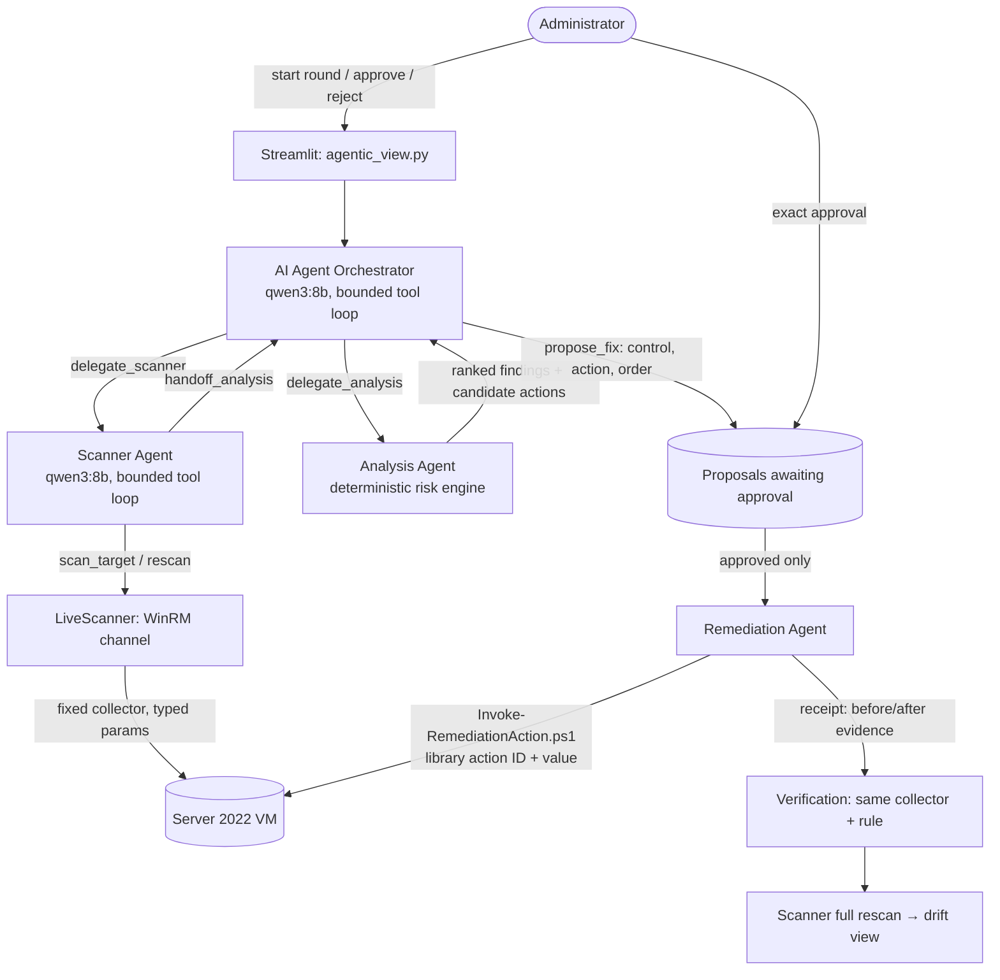

# Agentic framework architecture

Current design as of 26 October 2026. It implements decisions D1–D6 in [AGENTS.md](AGENTS.md). Page: **Agentic hardening** (default page of `app.py`).

## Who decides what

| Role | Engine | Decides | Cannot |
| --- | --- | --- | --- |
| AI Agent Orchestrator | Local LLM ([agentic.py](cis_compliance_dashboard_prototype/hardening/agentic.py) `OrchestratorTools`) | Delegation order; then one `submit_plan`: **which fixes to propose, in what order, and why every other fixable finding waits** | Scan, score, approve, execute; fix a gap, use an action outside the library or the finding's list, fix a blocked finding, leave a fixable finding undecided, or give a reason that contradicts the analysis |
| Scanner Agent | Local LLM (`ScannerTools`) + [winrm_channel.py](cis_compliance_dashboard_prototype/hardening/winrm_channel.py) | When to scan, whether coverage is acceptable, whether to rescan once (Error results only) | Change settings or send anything but the fixed collector |
| Analysis Agent | Deterministic ([risk.py](cis_compliance_dashboard_prototype/hardening/risk.py)) | Risk factors, score, level, ranking, candidate actions and prerequisites | Use the model (D2). Unknown/Error results are never scored |
| Remediation Agent | Deterministic ([remediation.py](cis_compliance_dashboard_prototype/hardening/remediation.py)) | Executes an approved request once; records verdict | Self-approve, retry, run unapproved/expired/changed-precondition requests |
| Administrator | Human | Approve or reject each proposal | — |

The Orchestrator and Scanner choose structured tool calls. Code validates every call, and rejected calls are recorded with no effect. A rejection names the exact problem, so the model can correct it once; two invalid calls end the run.

**Reasons are codes, not prose.** In an earlier trial, free-text reasons were invented: the model justified the anonymous-access fix with "remove unused services". So the Orchestrator now gives a reason code for each decision:
- fixes: `high_risk`, `unblocks_other`, `improves_detection` or `low_impact`;
- skips: `waits_for_prerequisite`, `needs_review` or `lower_priority`.

Code checks each code against the analysis. For example, `high_risk` needs a High or Critical finding, and `unblocks_other` needs another finding that is waiting on this control. Code then writes the sentence. The analysis hands the model only the codes that are true for each finding (`fix_codes`, `skip_codes`). The round summary is written by code from records. As a result, every reason shown to the administrator is true by construction, while the choices themselves (what, in what order, what waits) remain the model's.

Optional FR17 explanation: **Explain with local AI** on a ranked finding (`explain_finding`). It is text only and cannot change any number.

## Risk engine

`R = 6I + 5E + 4P + 3L + 2D`, from 20 to 100. Low is below 40, Moderate 40–59, High 60–79, Critical 80 and above. Ties are ordered by control ID.

- **I, P, L:** per-control baselines in `risk.BASELINES`, version `draft-2026-10-26`. **The researcher still needs to review them** before the evaluation chapter. `1.2.2` uses the report's own example (I4 P3 L3), which reproduces its 62 (no history) and 70 (confirmed regression) examples.
- **E:** set by the control's exposure surface (Table 4.14b): network logon 3, anonymous network 4, firewall 4, RDP 4, local secret 2, detection (audit/logging) 2. Add 1 when the collected *effective* Public firewall is disabled. A NAT lab never claims internet exposure.
- **D:** from the newest compatible earlier run of the same target (Table 4.14e): 1 when there is no history, 3 when the control was already non-compliant, 5 when it regressed.

## Pre-approved remediation library

Defined in two places that must agree. The Python metadata is [action_library.py](cis_compliance_dashboard_prototype/hardening/action_library.py). The fixed implementations are [Invoke-RemediationAction.ps1](scripts/Invoke-RemediationAction.ps1). `LibraryParityTests` checks that the two tables match.

| Action | Control | Implementation |
| --- | --- | --- |
| REM-1.1.1 / 1.1.2 / 1.1.3 / 1.1.4 | Password history 24 / max age 365 / min age 1 / min length 14 | `net accounts` with a constant option |
| REM-1.2.2, REM-1.2.1, REM-1.2.4 | Lockout threshold 5; duration 15 and reset 15 | `net accounts`. 1.2.1 requires 1.2.2 to be compliant; 1.2.4 requires 1.2.2 and 1.2.1 |
| REM-2.3.1.1 | Disable Guest (SID RID 501) | `Disable-LocalUser -SID` |
| REM-2.3.1.2, REM-2.3.10.2, REM-2.3.10.3 | LSA DWORDs = 1 | 64-bit registry `SetValue` |
| REM-17.1.1, 17.2.2, 17.2.3, 17.5.1, 17.5.4 | Advanced audit subcategories | `auditpol /set /subcategory:{GUID}` that only *enables* the required Success/Failure flags |
| REM-18.10.57.2.2, 3.9.1, 3.9.3, 3.9.5 | RDP policy values | 64-bit registry `CreateSubKey` + `SetValue` under `Policies\…\Terminal Services` |

That makes 20 actions for 32 assessed controls. These are assessment-only, with no action: `1.1.5` and `1.1.7` (need `secedit /configure`), `2.3.10.1`, NLA, and all **firewall policy** controls. Firewall policy writes could cut the agent's own WinRM channel, so they wait for a channel-safety precheck. Unconfigured policies are Unknown and get no action until decision D5.

## Remediation guarantees

- An approval is bound to the exact request bytes: target, control, action, value and observed before-value. It expires after 1 hour, and each proposal gets one decision.
- Inside the VM, before any write, the runner checks:
  - identity (hostname, UUID, admin token)
  - the request hash and library contract (value and type must match the script's table; no command field)
  - expiry
  - a fresh precondition read, which must equal the approved before-value
- It then writes a `CreateNew` ledger claim in `C:\ProgramData\FYP-ApprovedVmActions`, makes exactly one write, and re-collects the evidence.
- Python verifies the receipt with the same collector and rule. Running the command successfully is not the same as verifying the control.
- If the outcome is uncertain (channel lost, or a receipt that fails validation), it is recorded as unresolved and never retried. A failed verification gives no automatic second write.

## Evidence

- `tests/test_agentic.py`: full loop with a simulated VM and scripted models; skip, invalid and blocked proposals; model outage; scan failure; rescan rule; refused, expired and changed-precondition requests; execution failure; channel loss; risk arithmetic (62/70/67); library parity with real PowerShell.
- `tests/test_agentic_view.py`: page walkthrough covering round, approve, reject, execute and verification.
- `scripts/test_remediation_runner.ps1`: the runner's request guards.
- Real `qwen3:8b` against the simulated VM (`scripts/probe_agentic_round.py`), 32 controls, realistic lab state (default audit, unconfigured firewall/RDP policy), 26 Oct:
  - The **final design completed in 112 s**: one `submit_plan`, zero rejected calls, 7 fixes in exact risk order, every reason fact-checked.
  - Failed iterations are kept as evidence of why the design changed. One-call-per-fix exceeded the 300 s budget. Free-text reasons were inaccurate. Unconstrained reason codes were rejected twice for contradicting the facts.
- Real-VM remediation has not been run yet.
